<div align="center">

<h1> CleanCode</h1>

<h3>Limpeza, desempenho, proteção e monitor de hardware para macOS e Windows</h3>

<p>Descubra para onde foi o espaço do disco, limpe o que sobra, corrija o que quebrou,<br />acompanhe CPU, GPU, memória e energia em tempo real e jogue com o sistema no máximo.</p>

<p>
  <a href="https://github.com/marquessrafa/cleancode/releases/latest"></a>
  <a href="https://github.com/marquessrafa/cleancode/releases"></a>
  <a href="LICENSE"></a>
  
  
  <a href="https://github.com/marquessrafa/cleancode/actions/workflows/release.yml"></a>
</p>

<p>
  <a href="https://github.com/marquessrafa/cleancode/releases/latest"></a>
  <a href="https://github.com/marquessrafa/cleancode/releases/latest"></a>
  <a href="https://github.com/marquessrafa/cleancode/releases/latest"></a>
</p>

</div>

<p align="center">
  
</p>

---

## Sumário

- [O que é](#o-que-é)
- [Funcionalidades em imagens](#funcionalidades-em-imagens)
- [Tudo o que o CleanCode faz](#tudo-o-que-o-cleancode-faz)
- [Segurança e privacidade](#segurança-e-privacidade)
- [Download e instalação](#download-e-instalação)
- [Como funciona por dentro](#como-funciona-por-dentro)
- [Compilar a partir do código](#compilar-a-partir-do-código)
- [Inspiração](#inspiração)
- [Licença](#licença)

## O que é

O **CleanCode** é um app de manutenção para **macOS e Windows** que junta, num só lugar:

- **análise de disco** com treemap, tipos de arquivo, idade, duplicados e histórico;
- **manutenção**: limpeza, acúmulos, desempenho, proteção, registro/reparos, navegadores e Modo Jogo;
- **aplicativos**: desinstalador completo, com restos, e descoberta de apps esquecidos;
- **monitor de hardware** com cenas 3D animadas que reagem aos dados reais;
- um **painel na barra de menus** (macOS) ou na bandeja (Windows) com a saúde do computador em tempo real.

Tudo foi feito para ser **seguro por padrão**:
- o que é apagado vai para a Lixeira;
- as correções no registro têm backup;
- senhas e favoritos dos navegadores nunca são tocados;
- nada é removido sem você ver antes.

## Funcionalidades em imagens

### Análise de disco

<table>
  <tr>
    <td width="50%" valign="top"><br /><strong>Visão geral</strong><br />Unidades, espaço usado e livre, saúde do SSD e insights de limpeza.</td>
    <td width="50%" valign="top"><br /><strong>Visualizações</strong><br />Treemap com relevo 3D, pizza e barras: as pastas que mais pesam num relance.</td>
  </tr>
  <tr>
    <td width="50%" valign="top">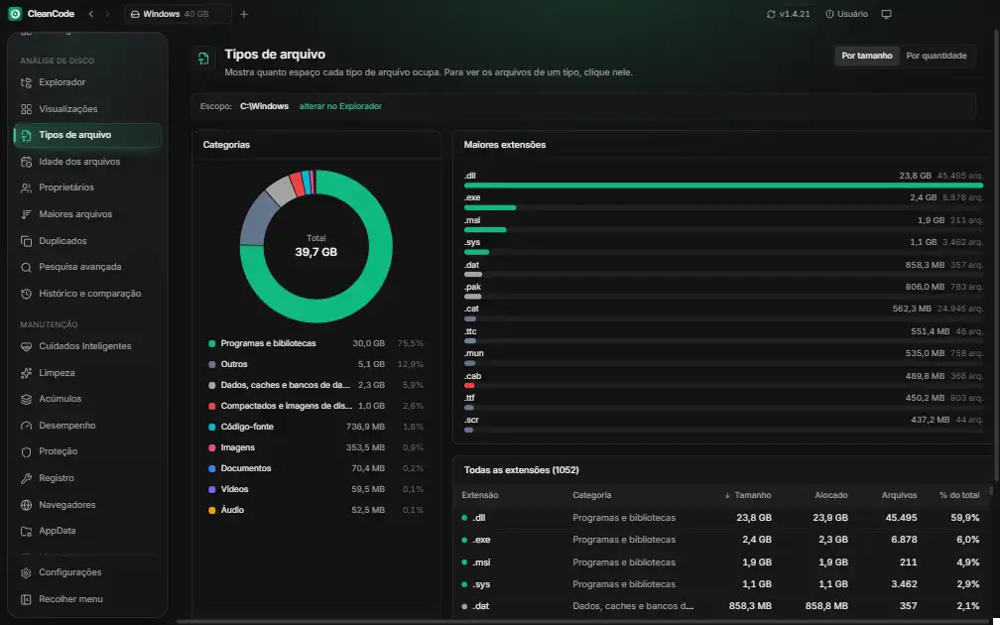<br /><strong>Tipos de arquivo</strong><br />Quanto cada extensão e categoria ocupa, com a lista de arquivos de cada uma.</td>
    <td width="50%" valign="top"><br /><strong>Cuidados Inteligentes</strong><br />Limpeza, proteção, desempenho e apps esquecidos numa análise só, com ação segura em um clique.</td>
  </tr>
</table>

### Manutenção

<table>
  <tr>
    <td width="50%" valign="top">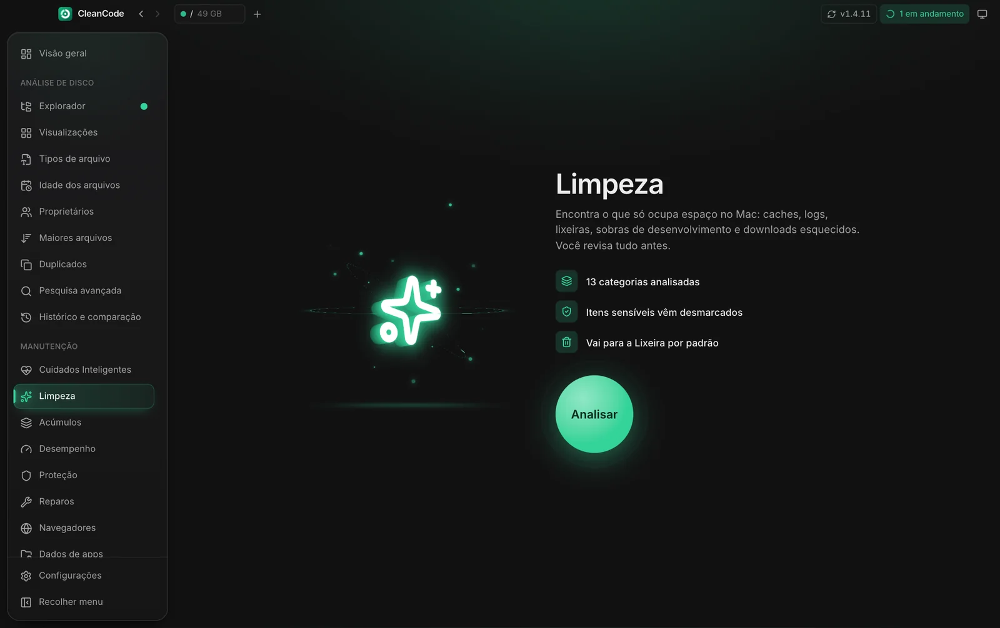<br /><strong>Limpeza</strong><br />Caches, logs, lixeiras, sobras de desenvolvimento e downloads esquecidos, revisados antes de sair.</td>
    <td width="50%" valign="top">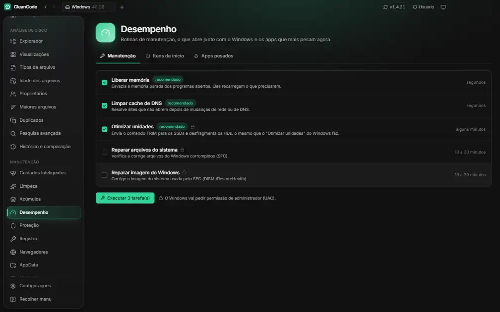<br /><strong>Desempenho</strong><br />Rotinas de manutenção do sistema, itens que iniciam sozinhos e apps que mais pesam agora.</td>
  </tr>
  <tr>
    <td width="50%" valign="top">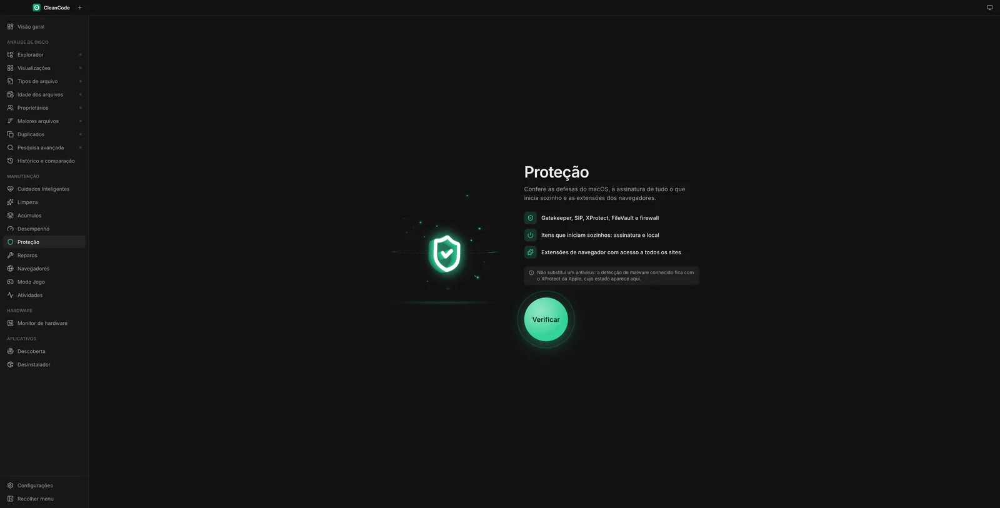<br /><strong>Proteção</strong><br />Defesas do sistema, assinatura e local de tudo o que inicia sozinho e extensões de navegador com acesso a todos os sites.</td>
    <td width="50%" valign="top">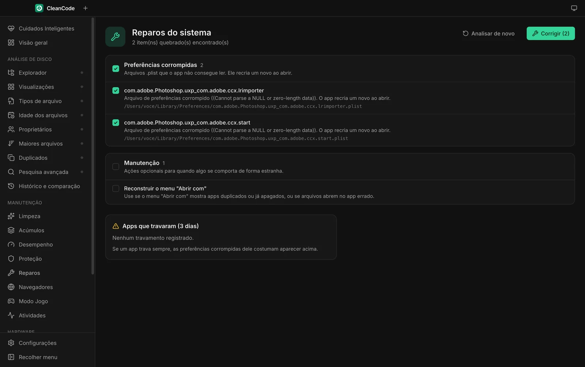<br /><strong>Registro do Windows / Reparos do macOS</strong><br />Só itens comprovadamente quebrados, com backup <code>.reg</code> e restauração. No Mac: preferências corrompidas e agentes órfãos.</td>
  </tr>
  <tr>
    <td width="50%" valign="top"><br /><strong>Navegadores</strong><br />Cache, histórico, downloads, cookies, sessões e preenchimento por perfil, mais otimização dos bancos internos.</td>
    <td width="50%" valign="top"><br /><strong>Modo Jogo</strong><br />Fecha o que pesa, libera memória e põe o sistema em desempenho máximo; ao encerrar, restaura tudo.</td>
  </tr>
</table>

### Monitor de hardware

<table>
  <tr>
    <td width="50%" valign="top">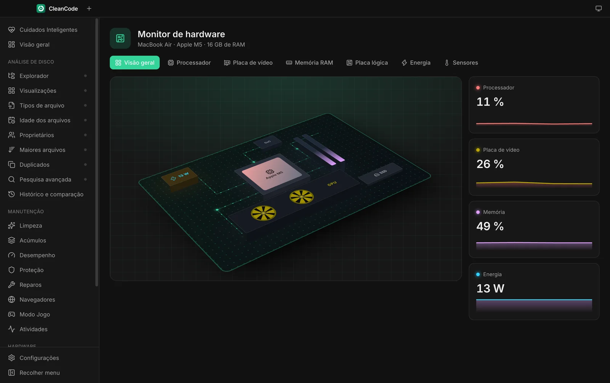<br /><strong>Visão geral</strong><br />Placa-mãe em 3D com trilhas de dados animadas. Clique em cada componente para abrir os detalhes.</td>
    <td width="50%" valign="top">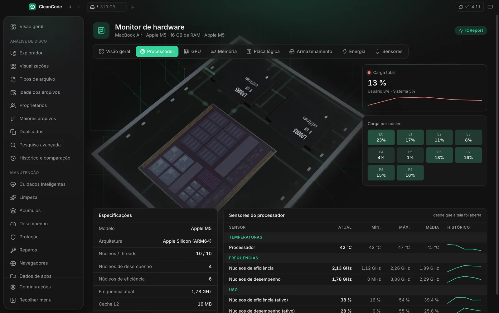<br /><strong>Processador</strong><br />Cada núcleo acende conforme a própria carga; núcleos de desempenho e de eficiência, cache e temperatura.</td>
  </tr>
  <tr>
    <td width="50%" valign="top"><br /><strong>Placa de vídeo</strong><br />Ventoinhas que aceleram com o uso da GPU, memória de vídeo, driver, temperatura e telas conectadas.</td>
    <td width="50%" valign="top"><br /><strong>Memória RAM</strong><br />Pentes que enchem com o uso; tipo, velocidade, fabricante, slots, pressão e swap.</td>
  </tr>
  <tr>
    <td width="50%" valign="top"><br /><strong>Energia</strong><br />Fluxo do carregador para a placa e a bateria, consumo em watts, tensão, corrente e saúde.</td>
    <td width="50%" valign="top"><br /><strong>Placa-mãe / placa lógica</strong><br />Soquete, reguladores, slots com os pentes RGB instalados, BIOS ou firmware, tensões e ventoinhas.</td>
  </tr>
</table>

<details>
<summary><strong>Mais: armazenamento, sensores e desinstalador</strong></summary>
<br />
<table>
  <tr>
    <td width="50%" valign="top"><br /><strong>Sensores</strong><br />Mapa térmico e tabela no estilo AIDA64 (atual, mínimo, máximo, média e histórico), com exportação CSV.</td>
    <td width="50%" valign="top">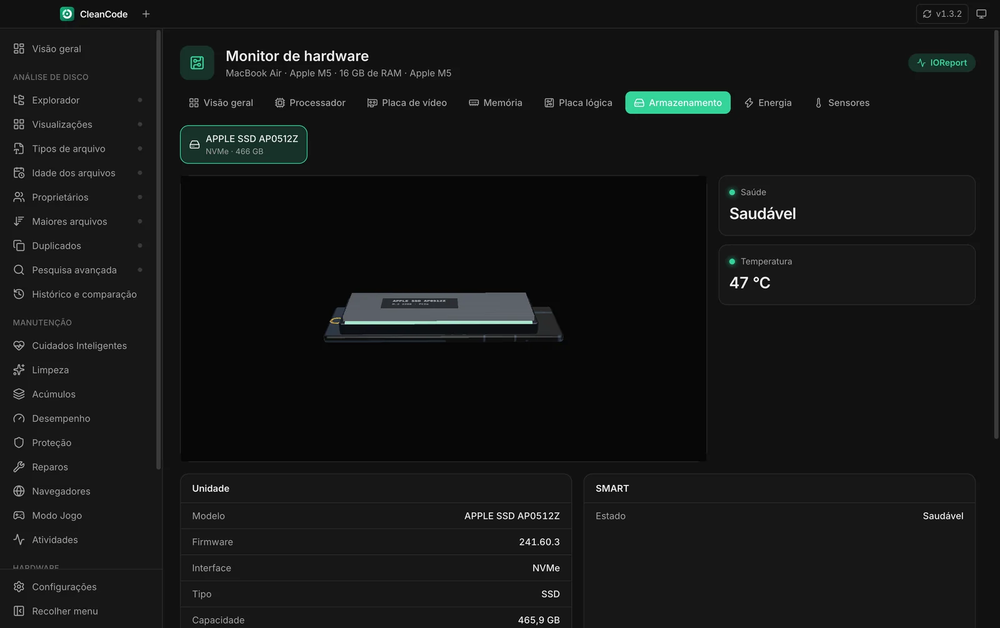<br /><strong>Armazenamento</strong><br />Cada disco em 3D com modelo, firmware, interface, saúde, temperatura, SMART e partições.</td>
  </tr>
  <tr>
    <td width="50%" valign="top"><br /><strong>Desinstalador</strong><br />Apps, pacotes da loja e restos em <code>~/Library</code> ou no registro, removidos em lote para a Lixeira.</td>
  </tr>
</table>
</details>

### Painel da barra de menus

<table>
  <tr>
    <td width="33%" valign="top">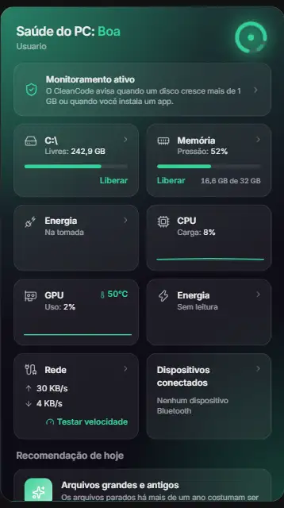<br /><strong>Saúde do computador</strong><br />Disco, memória, bateria, CPU, GPU, energia, rede e dispositivos, com um clique.</td>
    <td width="33%" valign="top"><br /><strong>Processador</strong><br />Usuário, sistema e disponível, temperatura, tempo ligado e maiores consumidores.</td>
    <td width="33%" valign="top">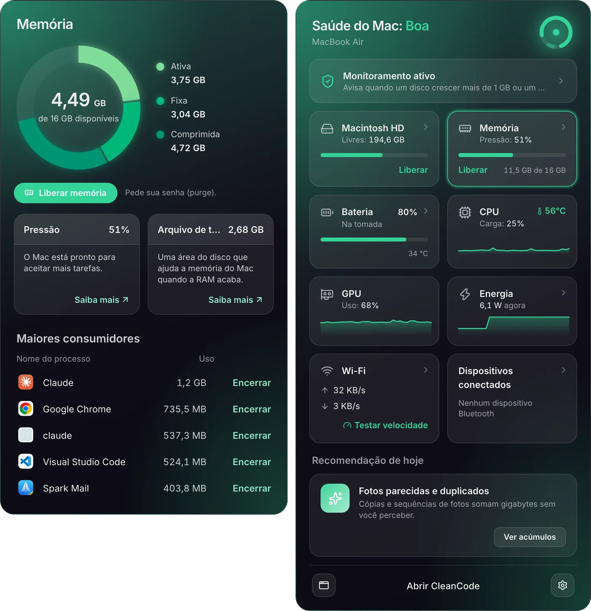<br /><strong>Memória</strong><br />Ativa, fixa e comprimida, pressão, swap e apps que mais usam.</td>
  </tr>
  <tr>
    <td width="33%" valign="top"><br /><strong>GPU</strong><br />Uso ao vivo, núcleos, memória, telas e temperatura.</td>
    <td width="33%" valign="top">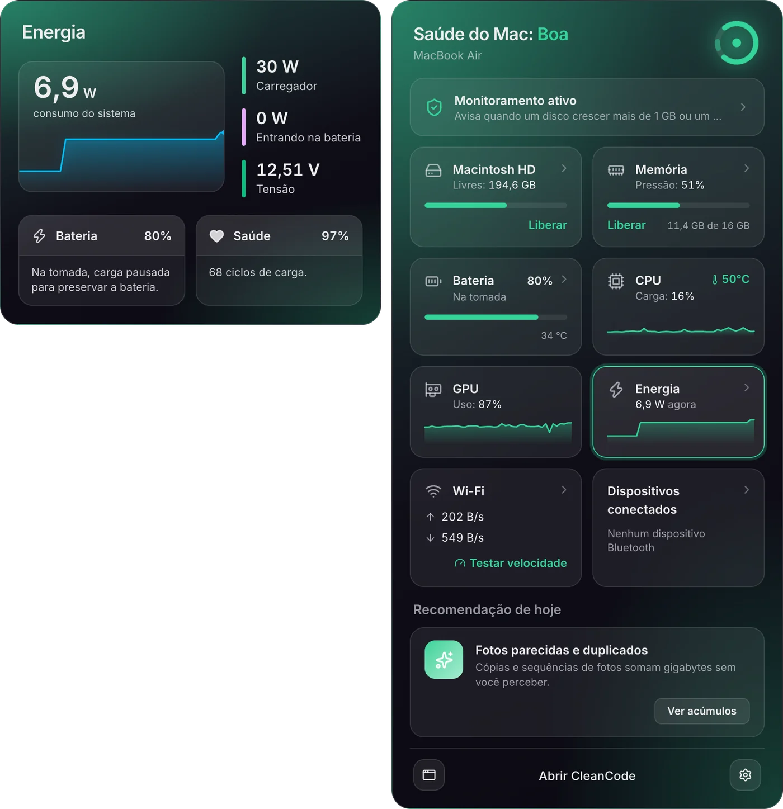<br /><strong>Energia</strong><br />Watts do sistema, carregador, entrada na bateria e tensão.</td>
    <td width="33%" valign="top"><br /><strong>Bateria</strong><br />Carga, ciclos, capacidade máxima e temperatura.</td>
  </tr>
  <tr>
    <td width="33%" valign="top">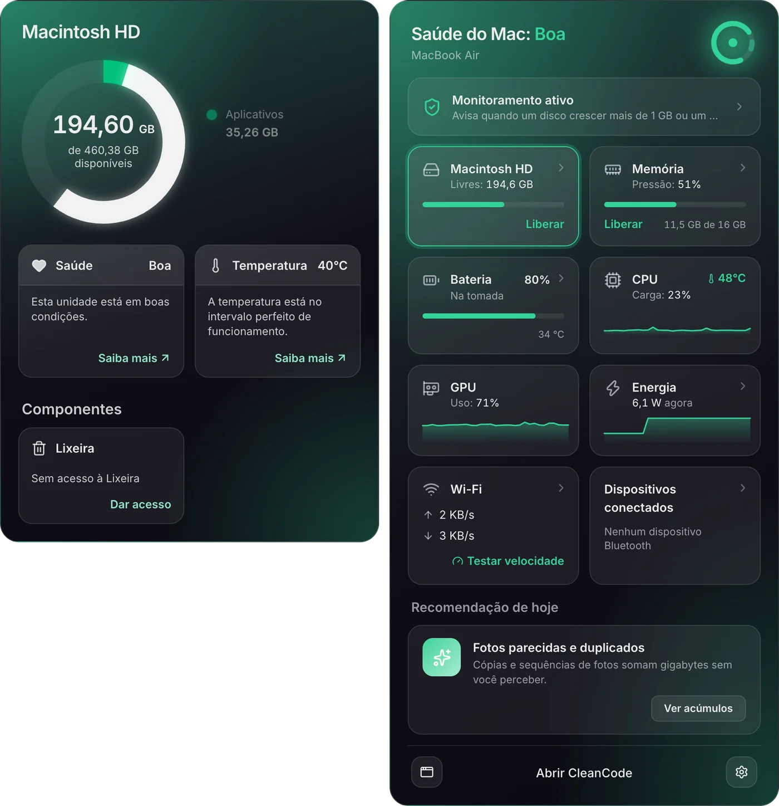<br /><strong>Armazenamento</strong><br />Categorias do disco, saúde do SSD e Lixeira.</td>
    <td width="33%" valign="top"><br /><strong>Rede</strong><br />Segurança do Wi-Fi, tráfego e teste de velocidade.</td>
    <td width="33%" valign="top"></td>
  </tr>
</table>

## Tudo o que o CleanCode faz

<details open>
<summary><strong>Análise de disco</strong></summary>

- **Varredura nativa e rápida**:
  - no Windows, via `FindFirstFileExW` com FFI (koffi), em worker thread;
  - no macOS, via `readdir` + `lstat` com tamanho real alocado (`blocks × 512`).
- **Explorador** em árvore com colunas configuráveis: tamanho, alocado, arquivos, %, data.
- **Visualizações**:
  - treemap com relevo (cushion), níveis de detalhe, rótulos e hierarquia;
  - gráfico de pizza;
  - gráfico de barras.
- **Tipos de arquivo**, **idade dos arquivos**, **proprietários**, **maiores arquivos** e **duplicados** (por conteúdo).
- **Pesquisa avançada** com filtros de nome, tamanho, data e tipo.
- **Histórico e comparação**: o que cresceu desde a última análise.
- Exportação para planilha e menu de contexto do sistema (abrir, mostrar no Finder/Explorer, propriedades).

</details>

<details open>
<summary><strong>Manutenção</strong></summary>

- **Cuidados Inteligentes**: limpeza, proteção, desempenho e apps esquecidos numa análise só.
- **Limpeza**:
  - caches do sistema e de apps, logs, Lixeira, sobras de desenvolvimento (Xcode, npm, Gradle…) e downloads antigos;
  - itens sensíveis vêm desmarcados e tudo vai para a Lixeira por padrão.
- **Acúmulos**: arquivos grandes e antigos, duplicados, fotos parecidas (hash perceptual) e a pasta Transferências.
- **Desempenho**:
  - liberar memória;
  - limpar o cache de DNS;
  - reduzir instantâneos locais;
  - scripts de manutenção e reindexação do Spotlight;
  - itens de início (ativar/desativar);
  - apps pesados.
- **Proteção**:
  - estado do Gatekeeper, SIP, XProtect, FileVault e firewall, ou do Defender, UAC, SmartScreen e firewall;
  - tudo o que inicia sozinho, com assinatura e local verificados;
  - extensões de navegador com acesso a todos os sites.
- **Registro do Windows / Reparos do macOS**:
  - **Windows:**
    - inicialização que aponta para programa removido;
    - programas fantasmas na lista de instalados;
    - App Paths;
    - "Abrir com";
    - menu do botão direito;
    - MuiCache;
    - atalhos quebrados;
    - serviços órfãos (só aviso);
    - backup `.reg` antes de cada mudança e restauração na própria tela.
  - **macOS:** preferências `.plist` corrompidas, agentes de inicialização órfãos, links quebrados e reconstrução do menu "Abrir com".
  - Lista de apps que travaram nos últimos 3 dias.
  - **Aviso em segundo plano** quando surge um item quebrado novo.
- **Navegadores**:
  - Chrome, Edge, Brave, Opera, Opera GX, Vivaldi, Chromium, Firefox e Safari, por perfil;
  - itens: cache e imagens, GPU e shaders, histórico, histórico de downloads, cookies e dados de sites, sessões e preenchimento automático;
  - **otimização** com `VACUUM` dos bancos internos;
  - fecha o navegador para você, sem forçar.
- **Modo Jogo**:
  - sessão que fecha apps em segundo plano e libera memória;
  - plano de energia de alto desempenho (Windows) ou desliga o Modo Pouca Energia (Mac);
  - prioridade alta para o jogo;
  - **restaura tudo ao encerrar**;
  - ajustes do Windows: Modo de Jogo, gravação do Xbox e agendamento de GPU;
  - limpeza dos caches de shaders (DirectX, NVIDIA, AMD, Intel e Metal);
  - jogos da Steam, Epic e GOG detectados.
- **Atividades**: histórico de tudo o que o CleanCode fez, com espaço liberado.

</details>

<details open>
<summary><strong>Monitor de hardware</strong></summary>

- **Processador:**
  - modelo, arquitetura, núcleos e threads, núcleos de desempenho e de eficiência;
  - frequência, cache L2/L3, temperatura;
  - carga total, usuário/sistema e **carga por núcleo**.
- **Placa de vídeo:**
  - modelo, fabricante, núcleos, API (Metal/DirectX), driver, memória de vídeo e em uso, temperatura;
  - telas conectadas;
  - processos que mais usam a GPU (Windows).
- **Memória RAM:** tipo (DDR4, DDR5, LPDDR5…), velocidade, fabricante, pentes e slots, composição (ativa, fixa, comprimida), pressão e swap.
- **Placa-mãe / placa lógica:** fabricante, modelo, revisão, chip, BIOS ou firmware e data.
- **Energia:** consumo do sistema em watts, carregador, potência entrando ou saindo da bateria, tensão, corrente, ciclos e saúde.
- **Armazenamento:** cada disco com modelo, firmware, interface, link, TRIM, saúde, temperatura, horas ligado, dados gravados e lidos, e partições.
- **Sensores no nível do AIDA64:** tabela por componente com valor atual, mínimo, máximo, média e minigráfico; mapa térmico; exportação CSV.
  - **Windows:** **LibreHardwareMonitor** integrado. Com o monitoramento avançado (driver PawnIO, assinado), lê temperatura e frequência por núcleo, tensões, ventoinhas da placa-mãe, consumo e SMART.
  - **Mac:** frequência e atividade dos grupos de núcleos e da GPU, e consumo, pelo IOReport, sem senha.
- **Modelos 3D (three.js)** com luz, reflexos e LEDs neon:
  - placa de vídeo, processador, RAM, placa-mãe, SSD e energia;
  - na visão geral, o seu computador: PC em gabinete de vidro, MacBook ou notebook Windows.

</details>

<details open>
<summary><strong>Aplicativos</strong></summary>

- **Desinstalador:**
  - apps em `/Applications` e `~/Applications`, programas Win32 e pacotes da Microsoft Store;
  - restos em `~/Library` ou no registro;
  - remoção em lote para a Lixeira.
- **Descoberta:** apps que você não abre há meses e quanto espaço eles liberam.
- **Aviso quando um app é instalado**, com o tamanho.

</details>

<details open>
<summary><strong>Painel da barra de menus / bandeja</strong></summary>

- Abre no canto da tela (superior direito no Mac, inferior direito no Windows), deslizando com fade.
- Cartões de disco, memória, bateria, CPU, **GPU**, **energia**, rede e dispositivos. Cada um abre um detalhe ao lado.
- **Teste de velocidade** da internet (latência, download e upload).
- Ejeção de discos externos, dispositivos Bluetooth com bateria e recomendação do dia.
- Cores na cor de destaque escolhida no app, com tema claro e escuro.

</details>

<details open>
<summary><strong>Segundo plano e atualizações</strong></summary>

- Fica na barra de menus/bandeja e avisa quando um disco cresce além do limite, quando um app é instalado ou quando aparece um item quebrado.
- **Atualizações automáticas**: baixa só o arquivo da arquitetura do seu computador, confere o SHA-512 e instala em silêncio.
- Na primeira abertura depois de atualizar, mostra uma janela com **as novidades da versão**.

</details>

## Segurança e privacidade

| O CleanCode… | Como |
|---|---|
| **Nunca apaga sem você ver** | Toda remoção passa por uma lista revisável. Só caminhos da última análise podem ser apagados. |
| **Prefere a Lixeira** | Arquivos, apps e atalhos vão para a Lixeira. Exclusão definitiva só para cache e quando você escolhe. |
| **Faz backup do registro** | Cada chave é exportada para `.reg` antes de mudar, com restauração na própria tela. |
| **Preserva senhas e favoritos** | `Login Data`, `Bookmarks`, `logins.json`/`key4.db`, cartões e endereços dos navegadores nunca são tocados. |
| **Pede permissão quando precisa** | Ações de administrador mostram o pedido do próprio sistema (senha do macOS ou UAC). |
| **Não coleta dados** | Sem conta, sem telemetria. Só se conecta para buscar atualizações (GitHub) e para o teste de velocidade (Cloudflare), quando você pede. |

## Download e instalação

Baixe a versão mais recente em **[Releases](https://github.com/marquessrafa/cleancode/releases/latest)**:

| Sistema | Arquivo |
|---|---|
| macOS 12+ com Apple Silicon (M1, M2, M3, M4, M5) | `CleanCode-<versão>-macOS-Apple-Silicon.dmg` |
| macOS 12+ com Intel | `CleanCode-<versão>-macOS-Intel.dmg` |
| Windows 10/11 64 bits | `CleanCode-<versão>-Windows-x64.exe` |

**macOS:**
1. Abra o `.dmg` e arraste o CleanCode para Aplicativos.
2. O app usa assinatura ad-hoc (sem conta de desenvolvedor da Apple). Na primeira abertura, clique com o botão direito › **Abrir**, ou vá em Ajustes do Sistema › Privacidade e Segurança › **Abrir Mesmo Assim**.
3. Para analisar tudo, conceda **Acesso Total ao Disco** em Privacidade e Segurança. O app avisa e abre o painel certo.

**Windows:**
1. Rode o instalador.
2. Como ele não tem certificado de assinatura pago, o SmartScreen pode avisar: clique em **Mais informações › Executar assim mesmo**.

> Os `.zip` do macOS e os arquivos `latest*.yml` dos Releases são usados pelo atualizador embutido; não é preciso baixá-los.

## Como funciona por dentro

| Camada | Tecnologia |
|---|---|
| Interface | React 19, Tailwind CSS 4, Vite 8, ícones Lucide |
| App | Electron 45 (Node 24): processo principal, preload com `contextBridge` e janelas isoladas (`sandbox`, `contextIsolation`) |
| Sistema operacional | Camada `electron/platform/` com os mesmos contratos para cada sistema (`darwin/` e `win32/`) |
| Windows | FFI com [koffi](https://koffi.dev) para Win32 (`FindFirstFileExW`, `GetCompressedFileSizeW`…), PowerShell/CIM, `reg.exe`, contadores de desempenho |
| macOS | `diskutil`, `system_profiler`, `ioreg`, `launchctl`, `pmset`, `plutil`, `codesign`/`spctl` e um helper nativo em C (`cc-sensors`) para sensores IOHID |
| Dados dos navegadores | `node:sqlite` (`DatabaseSync`) embutido no Node 24 |
| 3D | [three.js](https://threejs.org) com PBR, bloom (`UnrealBloomPass`) e modelos procedurais próprios |
| Sensores | Windows: [LibreHardwareMonitor](https://github.com/LibreHardwareMonitor/LibreHardwareMonitor) (helper em C#) + driver [PawnIO](https://pawnio.eu) opcional; macOS: IOReport (`cc-power`) e IOHID (`cc-sensors`) |
| Trabalho pesado | `worker_threads` para varredura, tamanhos, limpeza e acúmulos, sem travar a interface |
| Build e distribuição | electron-builder (NSIS, DMG, ZIP), GitHub Actions, feed próprio com uma entrada por arquitetura e verificação SHA-512 |

Estrutura principal:

```
electron/            processo principal, IPC, workers e atualizador
electron/platform/   tudo o que conversa com o SO (darwin/ e win32/)
native/macos/        helper de sensores (C)
src/pages/           telas do app
src/panel/           painel da barra de menus / bandeja
release-notes/       notas técnicas de cada versão
docs/                guia de desenvolvimento e capturas de tela
```

## Compilar a partir do código

Requisitos: Node.js 22+ e npm. No macOS, as Command Line Tools do Xcode, para compilar o helper de sensores.

```bash
git clone https://github.com/marquessrafa/cleancode.git
```

```bash
cd cleancode && npm install
```

```bash
npm start
```

Para gerar os instaladores:

```bash
npm run dist:mac
```

```bash
npm run dist
```

- `npm run dist:mac` (no Mac) gera os `.dmg` e `.zip` de Apple Silicon e Intel.
- `npm run dist` (no Windows) gera o instalador x64.
- Uma tag `vX.Y.Z` dispara o workflow que compila os dois sistemas e publica o Release com as notas de `release-notes/<versão>.md`.

Mais detalhes em [docs/DESENVOLVIMENTO.md](docs/DESENVOLVIMENTO.md).

## Inspiração

O CleanCode começou como um analisador de disco para Windows inspirado no **TreeSize**, da JAM Software: varredura rápida, árvore de pastas, treemap, tipos, idade, proprietários e duplicados. Ao chegar ao macOS, ganhou as áreas de manutenção e o painel na barra de menus inspirados no **CleanMyMac**, da MacPaw. A partir daí vieram recursos próprios, como o monitor de hardware em 3D, o Modo Jogo e os reparos do registro.

O CleanCode é um projeto independente, com design e código próprios. Não é afiliado à JAM Software nem à MacPaw, e não usa código, imagens ou recursos de outros produtos. Os nomes citados pertencem aos seus donos.

## Licença

[MIT](LICENSE). Use, estude, modifique e distribua à vontade.

Bibliotecas de terceiros: three.js (MIT), LibreHardwareMonitorLib (MPL 2.0). O driver PawnIO (GPL-2.0) não é distribuído com o CleanCode: ele é baixado do site oficial e instalado à parte, só quando você ativa o monitoramento avançado.
