<div align="center">

<h1> CleanCode</h1>

<!-- README_LANGUAGES_START -->
<p><sub><strong lang="en">🇬🇧 English</strong> · <a href="docs/readme/README_ES.md" lang="es">🇪🇸 Español</a> · <a href="docs/readme/README_PT-BR.md" lang="pt-BR">🇧🇷 Português (Brasil)</a></sub></p>
<!-- README_LANGUAGES_END -->

<h3>Cleanup, performance, protection and a hardware monitor for macOS and Windows</h3>

<p>CleanCode shows you where the space on your disk went and helps you delete what you no longer need.<br />In addition, it fixes broken system items and shows the use of your processor, graphics card, memory and power in real time.</p>

<p>
  <a href="https://github.com/marquessrafa/cleancode/releases/latest"></a>
  <a href="https://github.com/marquessrafa/cleancode/releases"></a>
  <a href="LICENSE"></a>
  
  
  <a href="https://github.com/marquessrafa/cleancode/actions/workflows/release.yml"></a>
</p>

<p>
  <a href="https://github.com/marquessrafa/cleancode/releases/latest"></a>
  <a href="https://github.com/marquessrafa/cleancode/releases/latest"></a>
  <a href="https://github.com/marquessrafa/cleancode/releases/latest"></a>
</p>

</div>

<p align="center">
  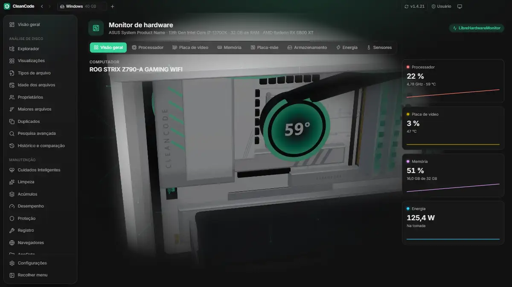
</p>

---

## Contents

- [What CleanCode is](#what-cleancode-is)
- [Features in pictures](#features-in-pictures)
- [Everything CleanCode does](#everything-cleancode-does)
- [Safety and privacy](#safety-and-privacy)
- [Download and installation](#download-and-installation)
- [How CleanCode works inside](#how-cleancode-works-inside)
- [How to build from source](#how-to-build-from-source)
- [Inspiration](#inspiration)
- [License](#license)

## What CleanCode is

**CleanCode** is a maintenance app for **macOS and Windows**. It brings five groups of tools together in one place:

- **Disk analysis** shows which folders and which file types take up the most space. It also finds old files, duplicate files and what has grown since the last analysis.
- **Maintenance** cleans leftover files, shows what starts together with the system, checks the system protections and fixes broken items. It also cleans your browsers and prepares the computer for games.
- **Apps** are uninstalled completely, together with the leftovers they leave in the system. In addition, CleanCode tells you which apps you have not opened for months.
- The **hardware monitor** shows each part of the computer in 3D. The models react to the real data from the processor, the graphics card, the memory and the power supply.
- The **menu bar panel** (on macOS) or the **tray panel** (on Windows) shows the health of your computer in real time, with one click.

CleanCode was built to be **safe from the start**:

- Deleted files go to the Trash, so you can recover everything.
- Before it changes the Windows registry, CleanCode makes a backup copy.
- CleanCode never deletes your browser passwords and bookmarks.
- CleanCode does not remove anything without showing you the list first.

> The app interface is in Brazilian Portuguese.

## Features in pictures

### Disk analysis

<table>
  <tr>
    <td width="50%" valign="top">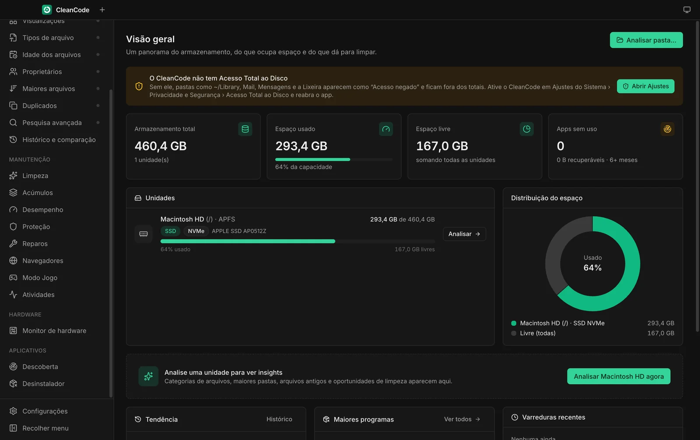<br /><strong>Overview</strong><br />Shows each disk with its used space and free space. Right below, the storage map shows how much space apps, documents, downloads, caches and the system take up.</td>
    <td width="50%" valign="top">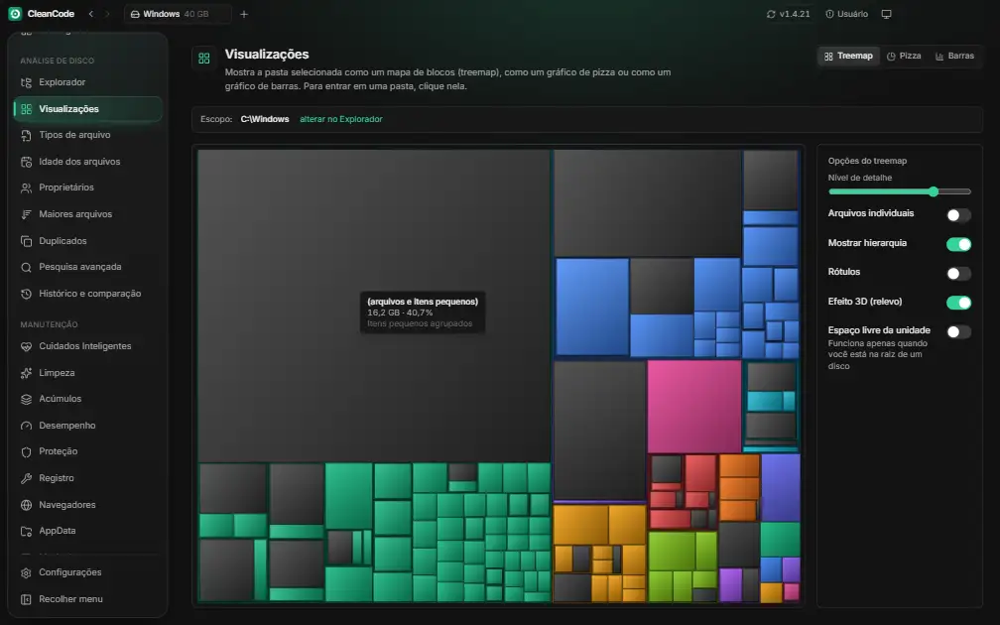<br /><strong>Visualizations</strong><br />Shows your folders as a block map (treemap), as a pie chart or as a bar chart. This way, you find the heaviest folders at a glance.</td>
  </tr>
  <tr>
    <td width="50%" valign="top"><br /><strong>File types</strong><br />Shows how much space each type of file takes up, such as videos, images and installers. When you click a type, CleanCode lists its files.</td>
    <td width="50%" valign="top"><br /><strong>Smart Care</strong><br />Runs the cleanup, the protection check, the performance check and the search for forgotten apps in a single analysis. Afterwards, you apply the safe actions with one click.</td>
  </tr>
</table>

### Maintenance

<table>
  <tr>
    <td width="50%" valign="top"><br /><strong>Cleanup</strong><br />Finds caches, activity records (logs), trash folders, leftovers from developer tools and forgotten downloads. You review the list before anything is deleted.</td>
    <td width="50%" valign="top"><br /><strong>Performance</strong><br />Runs system maintenance routines and shows the items that open together with the computer. In addition, it shows the apps that use the most resources right now.</td>
  </tr>
  <tr>
    <td width="50%" valign="top"><br /><strong>Protection</strong><br />Checks whether the system defenses are turned on. It also checks the signature and the location of everything that starts on its own, and it shows the browser extensions that can access every website.</td>
    <td width="50%" valign="top"><br /><strong>Windows Registry and macOS Repairs</strong><br />Shows only the items that are proven to be broken. On Windows, CleanCode saves a copy of the registry (a <code>.reg</code> file) before it fixes anything. On the Mac, it fixes corrupted preferences and agents that point to deleted apps.</td>
  </tr>
  <tr>
    <td width="50%" valign="top">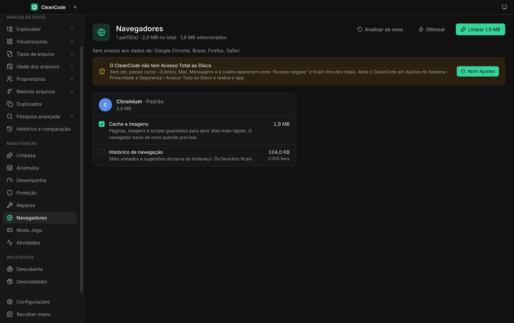<br /><strong>Browsers</strong><br />Cleans the cache, history, downloads, cookies, sessions and autofill data of each profile. In addition, it compacts the internal databases of your browsers.</td>
    <td width="50%" valign="top">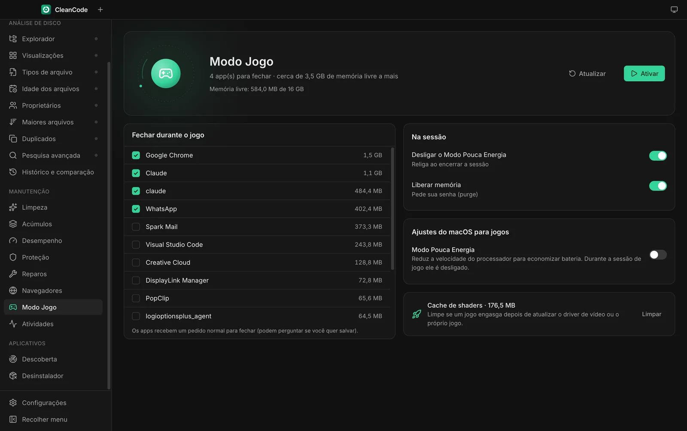<br /><strong>Game Mode</strong><br />Closes the heavy apps, frees memory and puts the system in maximum performance. When you end the session, CleanCode puts everything back the way it was.</td>
  </tr>
</table>

### Hardware monitor

<table>
  <tr>
    <td width="50%" valign="top"><br /><strong>Overview</strong><br />Shows your computer in 3D, whether it is a MacBook, a laptop or a desktop PC. The camera moves around the model, and the live numbers stay next to it.</td>
    <td width="50%" valign="top"><br /><strong>Processor</strong><br />Each core lights up according to its own load. The screen also shows the performance and efficiency cores, the cache memory and the temperature.</td>
  </tr>
  <tr>
    <td width="50%" valign="top">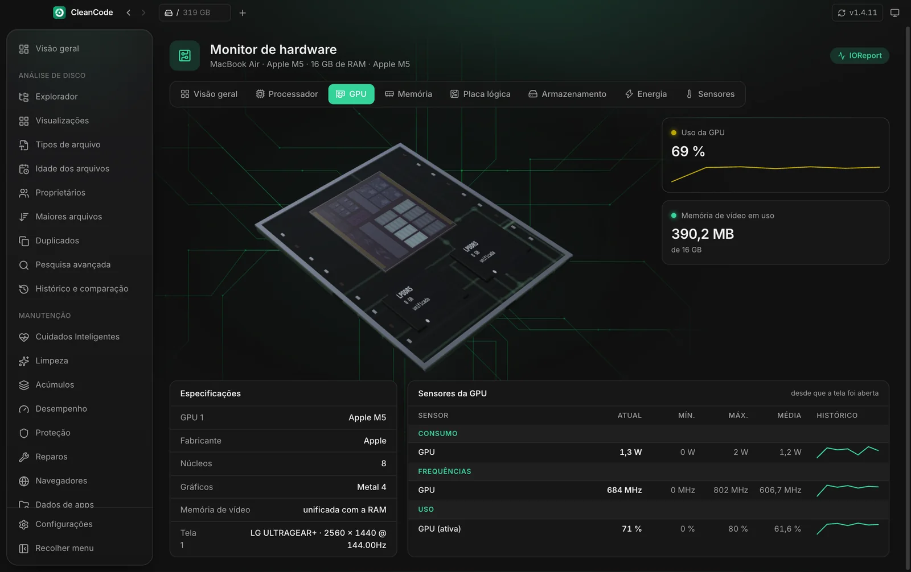<br /><strong>Graphics card</strong><br />Shows the graphics card usage, the video memory, the driver, the temperature and the connected displays. On a desktop PC, the fans of the 3D model spin faster when the usage goes up.</td>
    <td width="50%" valign="top">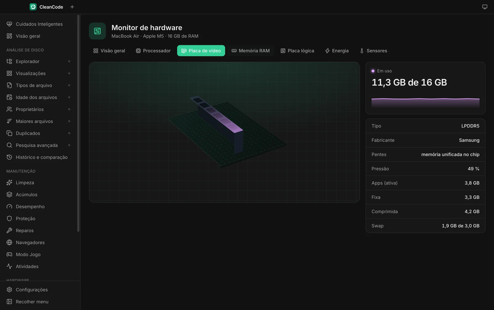<br /><strong>Memory (RAM)</strong><br />Shows the type, the speed and the manufacturer of the memory, as well as the occupied slots. It also shows the memory pressure and the use of swap, which is the extra memory stored on the disk.</td>
  </tr>
  <tr>
    <td width="50%" valign="top">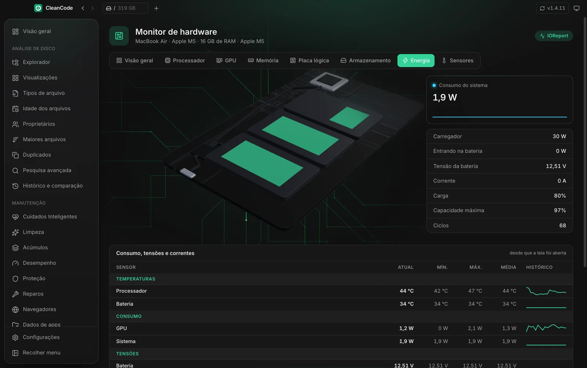<br /><strong>Power</strong><br />Shows how many watts the computer uses and how much power comes from the charger. It also shows the voltage, the current and the battery health.</td>
    <td width="50%" valign="top">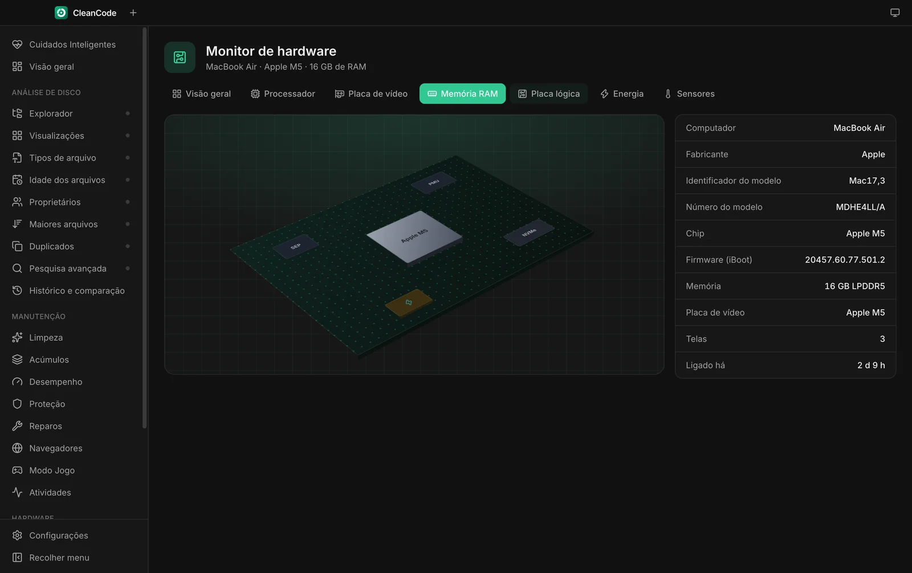<br /><strong>Motherboard and logic board</strong><br />Shows the board model, the chip, the firmware version (or the BIOS version, on a PC) and the voltages. On a PC, it also shows the fans and the installed memory modules.</td>
  </tr>
  <tr>
    <td width="50%" valign="top">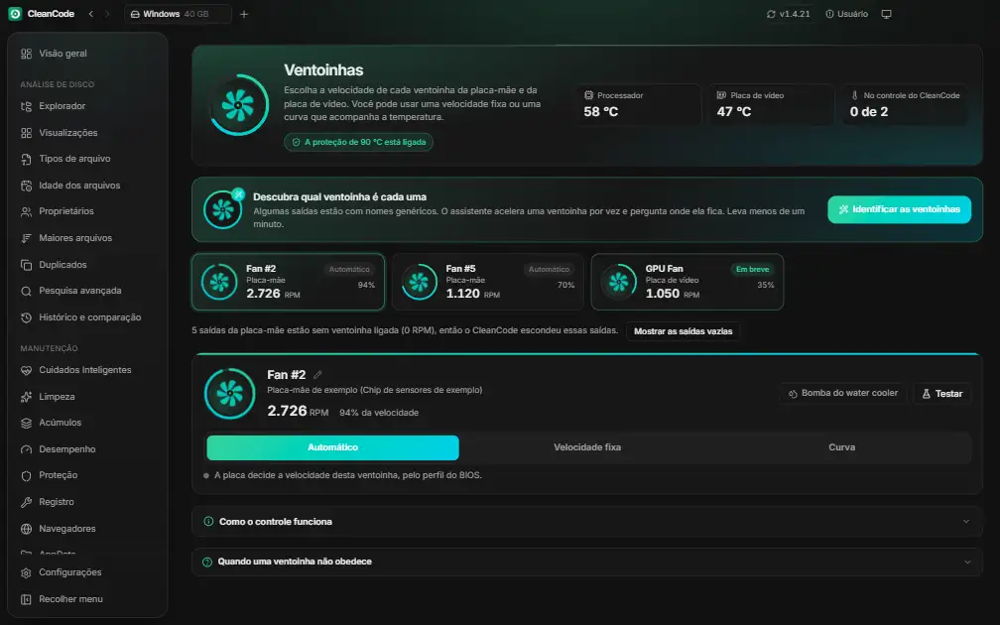<br /><strong>Fans</strong><br />On Windows, you choose a fixed speed or a temperature curve for each motherboard fan and for AMD graphics cards. An assistant finds out which fan is which, and each fan goes back to automatic mode when you close CleanCode.</td>
  </tr>
</table>

<details>
<summary><strong>More screens: storage, sensors and uninstaller</strong></summary>
<br />
<table>
  <tr>
    <td width="50%" valign="top">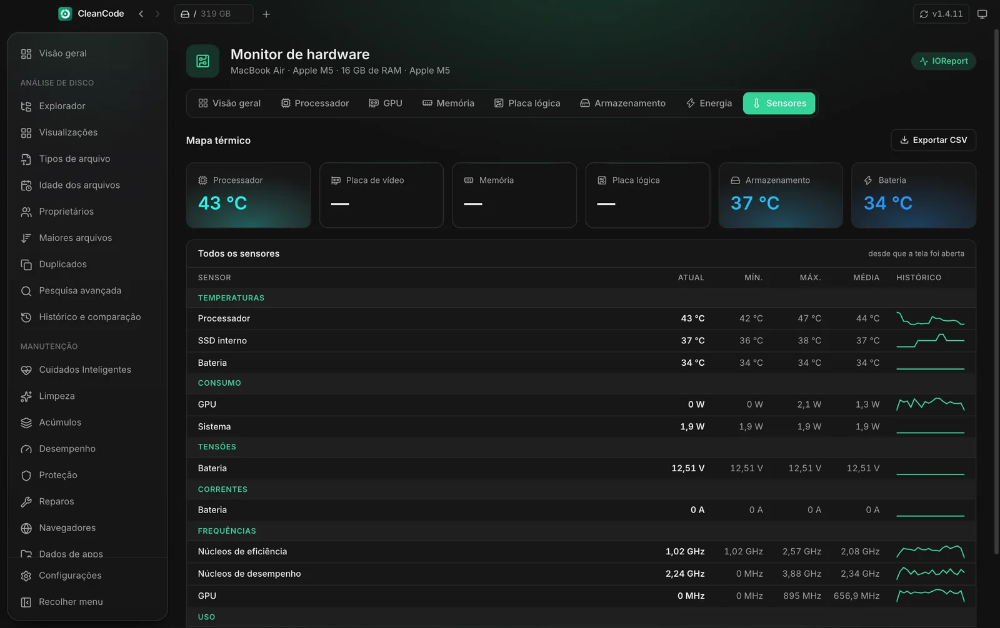<br /><strong>Sensors</strong><br />Shows a temperature map and a table with the current, minimum, maximum and average value of each sensor. You can export the table to a spreadsheet (a CSV file).</td>
    <td width="50%" valign="top"><br /><strong>Storage</strong><br />Shows each disk in 3D, with its model, firmware version, interface, health, temperature and partitions.</td>
  </tr>
  <tr>
    <td width="50%" valign="top">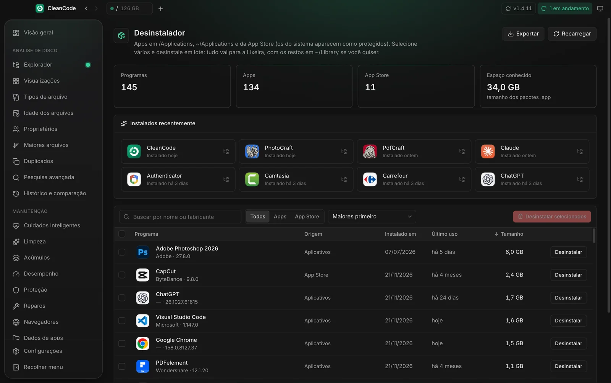<br /><strong>Uninstaller</strong><br />Removes apps, store packages and the leftovers they leave in <code>~/Library</code> (on the Mac) or in the registry (on Windows). You can remove several apps at once, and everything goes to the Trash.</td>
  </tr>
</table>
</details>

### Menu bar panel

<table>
  <tr>
    <td width="33%" valign="top"><br /><strong>Computer health</strong><br />Shows the disk, memory, battery, processor, graphics card, power, network and connected devices.</td>
    <td width="33%" valign="top">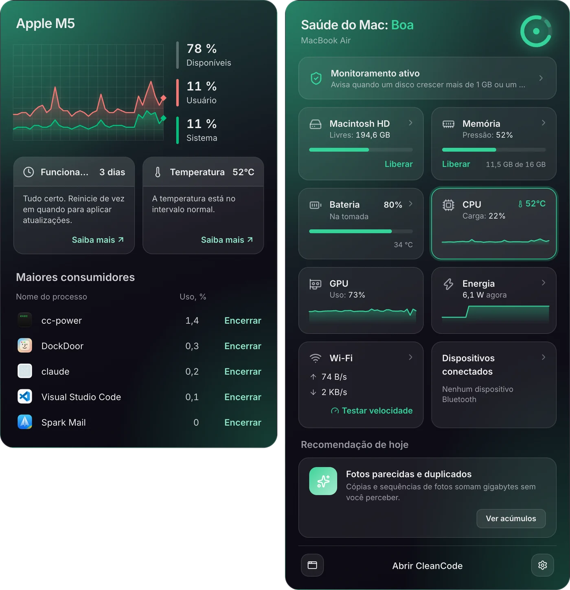<br /><strong>Processor</strong><br />Shows how much of the processor is in use by apps and by the system. It also shows the temperature, the uptime and the apps that use the processor the most.</td>
    <td width="33%" valign="top"><br /><strong>Memory</strong><br />Shows how the memory is divided, the memory pressure, the use of swap and the apps that use the most memory.</td>
  </tr>
  <tr>
    <td width="33%" valign="top">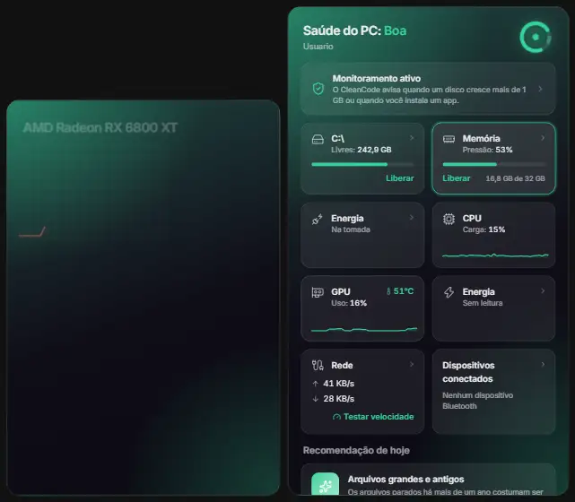<br /><strong>Graphics card</strong><br />Shows the live usage, the cores, the memory, the connected displays and the temperature.</td>
    <td width="33%" valign="top"><br /><strong>Power</strong><br />Shows the system consumption in watts, the charger power, the power that goes into the battery and the voltage.</td>
    <td width="33%" valign="top">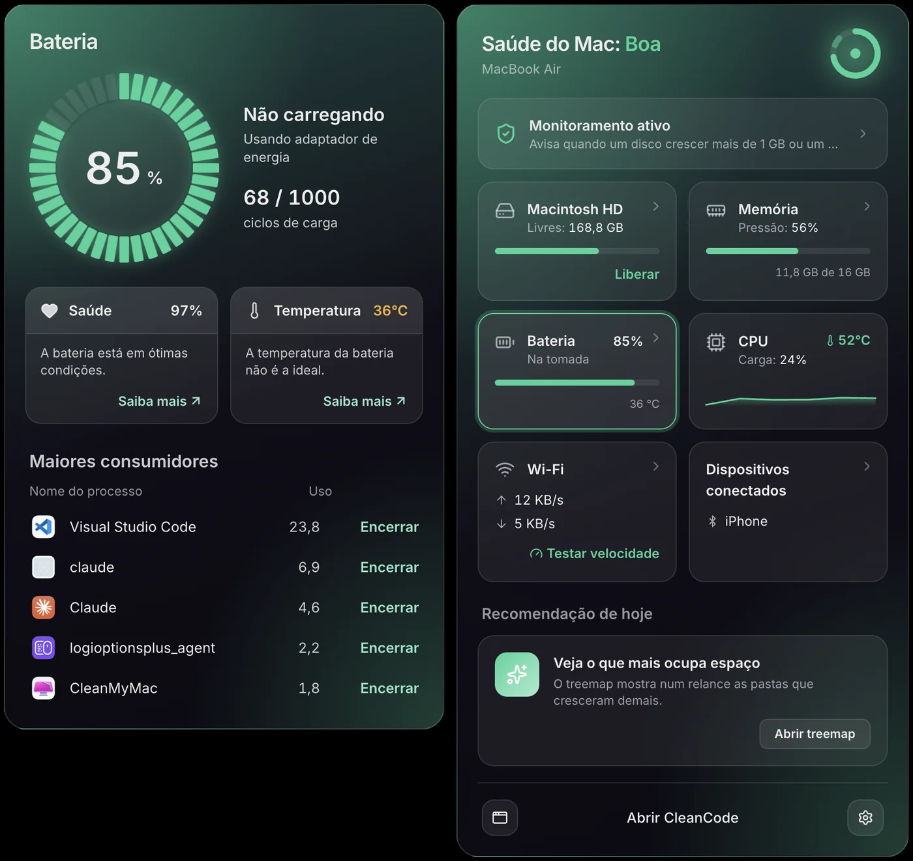<br /><strong>Battery</strong><br />Shows the charge, the number of cycles, the maximum capacity and the temperature of the battery.</td>
  </tr>
  <tr>
    <td width="33%" valign="top"><br /><strong>Storage</strong><br />Shows what takes up the disk, the health of the SSD and the size of the Trash.</td>
    <td width="33%" valign="top">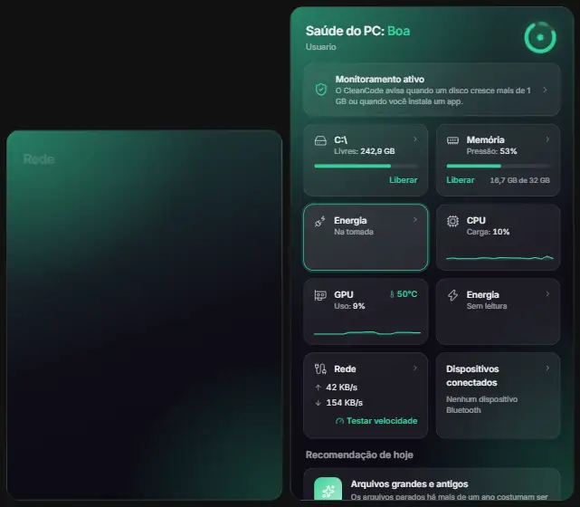<br /><strong>Network</strong><br />Shows whether your Wi-Fi is secure and how much data you downloaded and uploaded. In addition, it runs an internet speed test.</td>
    <td width="33%" valign="top"></td>
  </tr>
</table>

## Everything CleanCode does

<details open>
<summary><strong>Disk analysis</strong></summary>

- **The scan is native and fast.** On Windows, CleanCode reads folders with the system function `FindFirstFileExW`, through the koffi library, in a separate thread. On macOS, it uses `readdir` and `lstat` and calculates the space that each file really takes up on the disk.
- **The Explorer** shows folders as a tree. You choose the columns, such as size, allocated space, number of files, percentage and date.
- **The Visualizations** show the same folder in three ways:
  - a block map (treemap) with relief, levels of detail, labels and hierarchy;
  - a pie chart;
  - a bar chart.
- **Other analysis screens** show file types, file age, file owners, the largest files and duplicate files. Duplicates are confirmed by their content, and not only by their name.
- **Advanced search** filters files by name, size, date and type.
- **History and comparison** shows what has grown since the last analysis.
- You can export the results to a spreadsheet. In addition, the right-click menu lets you open a file, show it in Finder or in File Explorer, and see its properties.

</details>

<details open>
<summary><strong>Maintenance</strong></summary>

- **Smart Care** runs the cleanup, the protection check, the performance check and the search for forgotten apps in a single analysis.
- **Cleanup**:
  - finds system and app caches, activity records (logs), the Trash, leftovers from developer tools (such as Xcode, npm and Gradle) and old downloads;
  - leaves sensitive items unchecked and, by default, sends everything to the Trash.
- **Clutter** finds large and old files, duplicate files, similar photos and what was forgotten in the Downloads folder. To find similar photos, CleanCode compares how the images look.
- **Performance**:
  - frees memory;
  - clears the DNS cache, which stores website addresses;
  - reduces the local Time Machine snapshots;
  - runs the macOS maintenance scripts and rebuilds the Spotlight index;
  - turns on and off the items that open together with the computer;
  - shows the apps that use the most resources.
- **Protection**:
  - on the Mac, it checks Gatekeeper, SIP, XProtect, FileVault and the firewall; on Windows, it checks Defender, UAC, SmartScreen and the firewall;
  - checks the signature and the location of everything that starts on its own;
  - shows the browser extensions that can access every website.
- **Windows Registry and macOS Repairs**:
  - **On Windows**, CleanCode finds these problems:
    - startup items that point to a removed program;
    - ghost programs, which appear in the list of installed programs but were already removed;
    - broken app paths (App Paths);
    - broken entries in the "Open with" menu and in the right-click menu;
    - old entries in MuiCache;
    - broken shortcuts;
    - orphan services, which CleanCode only shows and does not change.

    Before each change, CleanCode saves a copy of the registry in a `.reg` file. If something goes wrong, you restore the copy on the same screen.
  - **On macOS**, CleanCode fixes corrupted preferences (`.plist` files), startup agents that point to deleted apps and broken links. It also rebuilds the "Open With" menu.
  - The screen shows the apps that crashed in the last 3 days.
  - When a new broken item appears, CleanCode lets you know, even when the window is closed.
- **Browsers**:
  - works with Chrome, Edge, Brave, Opera, Opera GX, Vivaldi, Chromium, Firefox and Safari, and it separates each profile;
  - cleans the cache and images, the graphics card data, the history, the download history, cookies and site data, sessions and autofill data;
  - compacts the internal databases of the browsers with the `VACUUM` command, which makes these files smaller;
  - asks you to close the browser before the cleanup and never forces the browser to close.
- **App data (AppData)**:
  - shows the size of each folder that programs keep in your profile (on Windows, `Local`, `Roaming` and `LocalLow`; on the Mac, `Application Support` and `Caches`);
  - safely cleans caches, activity records, crash reports and the old versions that updates leave behind;
  - finds the leftovers of uninstalled programs and sends them to the Trash.
- **Free memory** is available in the panel, on the Memory tab and in the icon menu.
- **Game Mode**:
  - during the session, closes background apps and frees memory;
  - on Windows, turns on the high-performance power plan; on the Mac, turns off Low Power Mode;
  - gives high priority to the game;
  - when you end the session, puts everything back the way it was;
  - on Windows, also adjusts Game Mode, Xbox recording and graphics card scheduling;
  - cleans the shader caches of DirectX, NVIDIA, AMD, Intel and Metal, which can grow large over time;
  - finds games from Steam, Epic and GOG on its own, and you can add other game folders.
- **Activity** shows the history of everything CleanCode has done and how much space each action freed.

</details>

<details open>
<summary><strong>Hardware monitor</strong></summary>

- **Processor**:
  - shows the model, the architecture, the number of cores and threads, and the split between performance cores and efficiency cores;
  - shows the frequency, the cache memory (L2 and L3) and the temperature;
  - shows the total load, the load from apps, the load from the system and the load of each core.
- **Graphics card**:
  - shows the model, the manufacturer, the cores, the graphics technology (Metal or DirectX), the driver, the video memory and the temperature;
  - shows the connected displays;
  - on Windows, shows the programs that use the graphics card the most.
- **Memory (RAM)**: shows the type (for example, DDR4, DDR5 or LPDDR5), the speed, the manufacturer, the modules and the slots. It also shows how the memory is divided, the memory pressure and the use of swap.
- **Motherboard and logic board**: shows the manufacturer, the model, the revision, the chip, the BIOS or firmware version and the date of that version.
- **Power**: shows the system consumption in watts, the charger power, the power that goes into or out of the battery, the voltage, the current, the cycles and the battery health.
- **Storage**: shows each disk with its model, firmware, interface, link speed, TRIM support, health, temperature, hours of use, data written and read, and partitions.
- **Sensors**: shows a table for each part with the current, minimum, maximum and average value and a small chart for each sensor. It also shows a temperature map, and you can export everything to a CSV file.
  - **On Windows**, CleanCode uses **LibreHardwareMonitor**. When you turn on advanced monitoring, which installs the signed PawnIO driver, CleanCode also reads the temperature and frequency of each core, the voltages, the motherboard fans, the power consumption and the SMART data of the disks.
  - **On the Mac**, CleanCode reads the frequency and activity of the cores and of the graphics card, as well as the power consumption. To do this, it uses the system IOReport and does not ask for a password.
- **3D models (made with three.js)**:
  - each part has a 3D model with a matte finish: graphics card, processor, memory, motherboard, SSD and power;
  - on the overview, the model is your own computer: a desktop PC with a glass case, a MacBook or a Windows laptop;
  - the camera moves around the model on its own, and animated circuits appear in the background.
- **Fans (Windows)**:
  - you choose, for each fan that accepts control, the automatic mode, a fixed speed or a curve that follows a temperature;
  - if the processor or the graphics card reaches 90 °C, the controlled fans go to 100% until the temperature drops to 85 °C;
  - after each command, CleanCode checks the value and the RPM that the board reports, and it returns the fan to automatic mode when the fan does not obey;
  - the "Identify the fans" assistant speeds up one fan at a time and asks where it is, and a guide explains what to do when a fan does not obey;
  - on AMD graphics cards (RX 5000 and newer), CleanCode controls the fan through the AMD driver (ADLX), and it restores the driver fan curve and Zero RPM when you go back to automatic mode;
  - NVIDIA and Intel graphics cards show only the fan speed for now, and their control arrives in a future version.

</details>

<details open>
<summary><strong>Apps</strong></summary>

- **Uninstaller**:
  - finds the apps in `/Applications` and in `~/Applications` on the Mac, and the programs and Microsoft Store packages on Windows;
  - finds the leftovers of the apps in `~/Library` (on the Mac) or in the registry (on Windows);
  - removes several apps at once and sends everything to the Trash.
- **App dossier**: each app has its own screen. This screen shows who made the app, its license, its version, its installation date, the space it takes up and its data folders.
- **Discover** shows the apps that you have not opened for months and how much space they would free.
- **Install notice**: when you install an app, CleanCode tells you how much space it took up.

</details>

<details open>
<summary><strong>Menu bar and tray panel</strong></summary>

- The panel opens in the corner of the screen. On the Mac, it appears in the top-right corner. On Windows, it appears in the bottom-right corner.
- The panel has cards for the disk, memory, battery, processor, graphics card, power, network and devices. When you click a card, its details open next to it.
- The **speed test** measures the latency, the download speed and the upload speed of your internet connection.
- The panel also ejects external disks, shows the battery of Bluetooth devices and makes one recommendation per day.
- The colors follow the accent color that you chose in the app, in both the light theme and the dark theme.

</details>

<details open>
<summary><strong>Background work and updates</strong></summary>

- CleanCode stays in the menu bar (on the Mac) or in the tray (on Windows). From there, it lets you know when a disk grows beyond the limit, when an app is installed or when a broken item appears.
- **Updates**: CleanCode checks for new versions every 3 minutes and also when the computer wakes up from sleep. When it finds a new version, it shows a notice in the center of the screen with what is new.
  - If you click **Update now** (in Portuguese, "Atualizar agora"), the notice shows the download and each step of the installation. CleanCode restarts only when the installation is finished.
  - If you prefer to update later, CleanCode downloads the new version on its own and installs it when you close the window.
  - In every case, CleanCode downloads only the file that was made for your computer and checks the SHA-512 code of the file before it installs anything.
- The first time you open CleanCode after an update, it shows a window with **what is new in that version**.

</details>

## Safety and privacy

| CleanCode… | How it does this |
|---|---|
| **Never deletes anything without showing it first** | Every removal goes through a list that you review. In addition, CleanCode only deletes paths that appeared in the last analysis. |
| **Prefers the Trash** | Files, apps and shortcuts go to the Trash. CleanCode only deletes cache files and the items you choose permanently. |
| **Backs up the registry** | Before it changes a registry key, CleanCode saves the key in a `.reg` file. You restore the copy on the same screen. |
| **Keeps passwords and bookmarks** | CleanCode never touches the files that store browser passwords, bookmarks, cards and addresses, such as `Login Data`, `Bookmarks`, `logins.json` and `key4.db`. |
| **Asks for permission when it needs it** | Administrator actions show the request from the system itself, that is, the macOS password prompt or the UAC window on Windows. |
| **Does not collect data** | CleanCode has no account and no telemetry. It only connects to the internet to look for updates on GitHub and to run the speed test on Cloudflare, when you ask for it. |

## Download and installation

Download the latest version from the **[Releases](https://github.com/marquessrafa/cleancode/releases/latest)** page:

| System | File |
|---|---|
| macOS 12 or newer, with Apple Silicon (M1, M2, M3, M4 or M5) | `CleanCode-<version>-macOS-Apple-Silicon.dmg` |
| macOS 12 or newer, with an Intel processor | `CleanCode-<version>-macOS-Intel.dmg` |
| Windows 10 or 11, 64-bit | `CleanCode-<version>-Windows-x64.exe` |

**On macOS:**

1. Open the `.dmg` file and drag CleanCode to the Applications folder.
2. The app has its own signature, because it does not use a paid Apple developer account. For this reason, the first time you open it, right-click the app and choose **Open**. Another option is to go to System Settings, then to Privacy & Security, and click **Open Anyway**.
3. So that CleanCode can analyze every folder, give it **Full Disk Access** in Privacy & Security. The app lets you know when this permission is missing and opens the right settings panel for you.

**On Windows:**

1. Open the installer.
2. The installer does not have a paid signing certificate, so SmartScreen may show a warning. In this case, click **More info** and then **Run anyway**.

> The macOS `.zip` files and the `latest*.yml` files on the Releases page are used by the app updater. You do not need to download these files.

## How CleanCode works inside

| Layer | Technology |
|---|---|
| Interface | React 19, Tailwind CSS 4, Vite 8 and Lucide icons. |
| App | Electron 45 with Node 24. The main process talks to the windows through a preload script with `contextBridge`, and the windows are isolated (`sandbox` and `contextIsolation`). |
| Operating system | The `electron/platform/` folder has the same functions for each system, split into `darwin/` (macOS) and `win32/` (Windows). |
| Windows | Direct calls to Windows functions with the [koffi](https://koffi.dev) library (for example, `FindFirstFileExW` and `GetCompressedFileSizeW`), as well as PowerShell, CIM, `reg.exe` and performance counters. |
| macOS | System tools such as `diskutil`, `system_profiler`, `ioreg`, `launchctl`, `pmset`, `plutil`, `codesign` and `spctl`. The sensors are read by our own program written in C (`cc-sensors`). |
| Browser data | The `node:sqlite` module (`DatabaseSync`), which comes with Node 24. |
| 3D | [three.js](https://threejs.org) with our own models, a matte finish and a camera that moves on its own. |
| Sensors | On Windows, [LibreHardwareMonitor](https://github.com/LibreHardwareMonitor/LibreHardwareMonitor) (through a helper program in C#) and, if you want it, the [PawnIO](https://pawnio.eu) driver. On macOS, IOReport (`cc-power`) and IOHID (`cc-sensors`). |
| Heavy work | The scan, the size calculation, the cleanup and the clutter search run in `worker_threads`, so the interface does not freeze. |
| Build and distribution | electron-builder creates the installers (NSIS, DMG and ZIP). GitHub Actions builds both systems and publishes an update feed with one entry for each architecture and with SHA-512 verification. |

These are the main folders of the project:

```
electron/            main process, communication between windows, workers and updater
electron/platform/   everything that talks to the operating system (darwin/ and win32/)
native/macos/        helper program that reads the sensors on the Mac (written in C)
src/pages/           app screens
src/panel/           menu bar and tray panel
release-notes/       technical notes for each version
docs/                development guide, README translations and screenshots
```

## How to build from source

You need Node.js 22 or newer and npm. On macOS, you also need the Xcode Command Line Tools, because they compile the program that reads the sensors.

```bash
git clone https://github.com/marquessrafa/cleancode.git
```

```bash
cd cleancode && npm install
```

```bash
npm start
```

To create the installers, use one of these commands:

```bash
npm run dist:mac
```

```bash
npm run dist
```

- The `npm run dist:mac` command runs on the Mac and creates the `.dmg` and `.zip` files for Apple Silicon and for Intel.
- The `npm run dist` command runs on Windows and creates the 64-bit installer.
- When you create a tag in the `vX.Y.Z` format, GitHub Actions builds both systems and publishes the version with the notes from the `release-notes/<version>.md` file.

The [docs/DESENVOLVIMENTO.md](docs/DESENVOLVIMENTO.md) guide has more details. This guide is written in Portuguese.

## Inspiration

CleanCode started as a disk analyzer for Windows inspired by **TreeSize**, from JAM Software. That first version already had the fast scan, the folder tree, the treemap and the screens for file types, file age, file owners and duplicates. Later, when it came to macOS, CleanCode gained the maintenance areas and the menu bar panel, inspired by **CleanMyMac**, from MacPaw. After that, it gained its own features, such as the 3D hardware monitor, Game Mode and the registry repairs.

CleanCode is an independent project, with its own design and its own code. It has no connection with JAM Software or with MacPaw, and it does not use code, images or resources from other products. The names mentioned here belong to their owners.

## License

CleanCode uses the [MIT](LICENSE) license. This means that you can use, study, change and share the code freely.

The app uses these third-party libraries: three.js (MIT license) and LibreHardwareMonitorLib (MPL 2.0 license). The PawnIO driver (GPL-2.0 license) does not come with CleanCode. It is downloaded from its official website and installed separately, and only when you turn on advanced monitoring.

TechPowerUp provided the graphics card photos that appear on the Fans screen, and CleanCode uses them with permission. AMD, Radeon, NVIDIA, GeForce, Intel and Arc are trademarks of their respective owners. CleanCode has no ties to these companies.
