<div align="center">

<h1> CleanCode</h1>

<!-- README_LANGUAGES_START -->
<p><sub><a href="../../README.md" lang="en">🇬🇧 English</a> · <strong lang="es">🇪🇸 Español</strong> · <a href="README_PT-BR.md" lang="pt-BR">🇧🇷 Português (Brasil)</a></sub></p>
<!-- README_LANGUAGES_END -->

<h3>Limpieza, rendimiento, protección y monitor de hardware para macOS y Windows</h3>

<p>CleanCode te muestra a dónde fue el espacio de tu disco y te ayuda a borrar lo que ya no necesitas.<br />Además, corrige elementos rotos del sistema y muestra el uso del procesador, de la tarjeta gráfica, de la memoria y de la energía en tiempo real.</p>

<p>
  <a href="https://github.com/marquessrafa/cleancode/releases/latest"></a>
  <a href="https://github.com/marquessrafa/cleancode/releases"></a>
  <a href="../../LICENSE"></a>
  
  
  <a href="https://github.com/marquessrafa/cleancode/actions/workflows/release.yml"></a>
</p>

<p>
  <a href="https://github.com/marquessrafa/cleancode/releases/latest"></a>
  <a href="https://github.com/marquessrafa/cleancode/releases/latest"></a>
  <a href="https://github.com/marquessrafa/cleancode/releases/latest"></a>
</p>

</div>

<p align="center">
  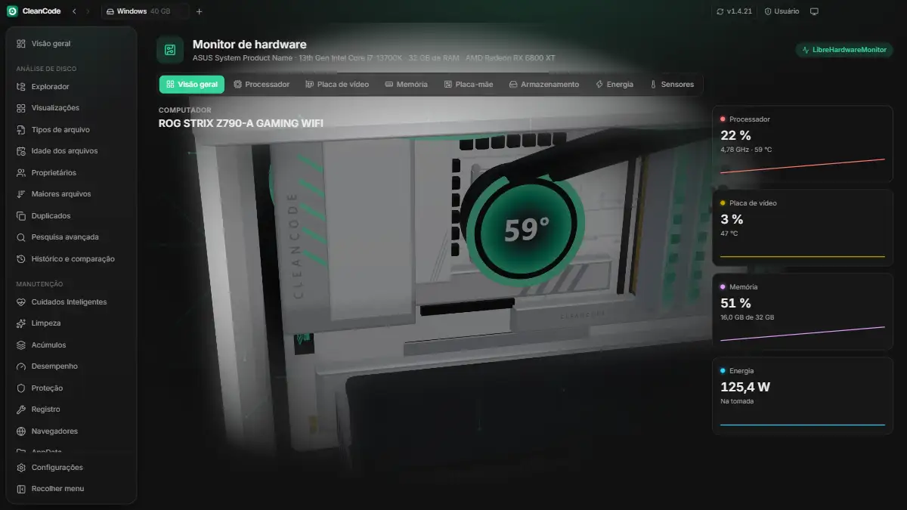
</p>

---

## Índice

- [Qué es CleanCode](#qué-es-cleancode)
- [Funciones en imágenes](#funciones-en-imágenes)
- [Todo lo que hace CleanCode](#todo-lo-que-hace-cleancode)
- [Seguridad y privacidad](#seguridad-y-privacidad)
- [Descarga e instalación](#descarga-e-instalación)
- [Cómo funciona CleanCode por dentro](#cómo-funciona-cleancode-por-dentro)
- [Cómo compilar desde el código](#cómo-compilar-desde-el-código)
- [Inspiración](#inspiración)
- [Licencia](#licencia)

## Qué es CleanCode

**CleanCode** es una app de mantenimiento para **macOS y Windows**. Reúne, en un solo lugar, cinco grupos de herramientas:

- El **análisis de disco** muestra qué carpetas y qué tipos de archivo ocupan más espacio. También encuentra archivos antiguos, archivos duplicados y lo que creció desde el último análisis.
- El **mantenimiento** limpia los archivos que sobran, muestra lo que se inicia junto con el sistema, revisa las protecciones del sistema y corrige elementos rotos. También limpia los navegadores y prepara el ordenador para jugar.
- Las **apps** se desinstalan por completo, junto con los restos que dejan en el sistema. Además, CleanCode te avisa qué apps no abres desde hace meses.
- El **monitor de hardware** muestra cada pieza del ordenador en 3D. Los modelos reaccionan a los datos reales del procesador, de la tarjeta gráfica, de la memoria y de la energía.
- El **panel de la barra de menús** (en macOS) o de la **bandeja del sistema** (en Windows) muestra la salud del ordenador en tiempo real, con un clic.

CleanCode fue hecho para ser **seguro desde el principio**:

- Los archivos borrados van a la Papelera, así que puedes recuperarlo todo.
- Antes de cambiar el registro de Windows, CleanCode hace una copia de seguridad.
- CleanCode nunca borra las contraseñas ni los marcadores de los navegadores.
- CleanCode no elimina nada sin mostrarte la lista antes.

> La interfaz de la app está en portugués de Brasil.

## Funciones en imágenes

### Análisis de disco

<table>
  <tr>
    <td width="50%" valign="top">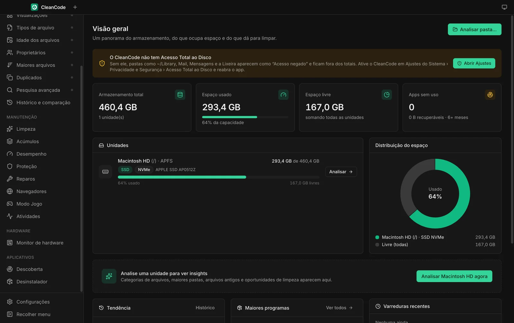<br /><strong>Visión general</strong><br />Muestra cada disco con el espacio usado y el espacio libre. Justo debajo, el mapa del almacenamiento muestra cuánto ocupan las apps, los documentos, las descargas, las cachés y el sistema.</td>
    <td width="50%" valign="top">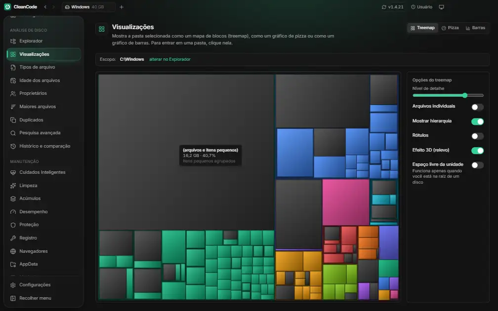<br /><strong>Visualizaciones</strong><br />Muestra las carpetas en un mapa de bloques (treemap), en un gráfico circular o en un gráfico de barras. Así, encuentras las carpetas más pesadas de un vistazo.</td>
  </tr>
  <tr>
    <td width="50%" valign="top">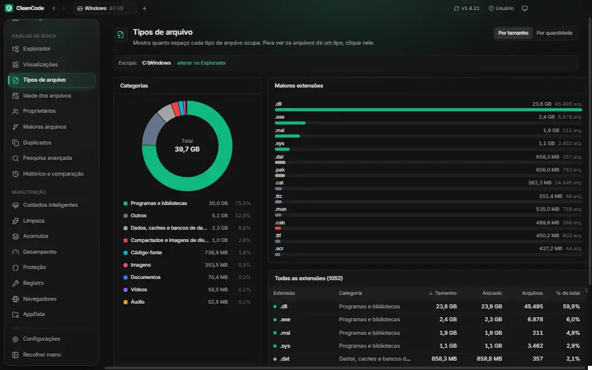<br /><strong>Tipos de archivo</strong><br />Muestra cuánto espacio ocupa cada tipo de archivo, como vídeos, imágenes e instaladores. Cuando haces clic en un tipo, CleanCode muestra la lista de sus archivos.</td>
    <td width="50%" valign="top"><br /><strong>Cuidados Inteligentes</strong><br />Hace la limpieza, la revisión de protección, la revisión de rendimiento y la búsqueda de apps olvidadas en un único análisis. Después, aplicas las acciones seguras con un clic.</td>
  </tr>
</table>

### Mantenimiento

<table>
  <tr>
    <td width="50%" valign="top">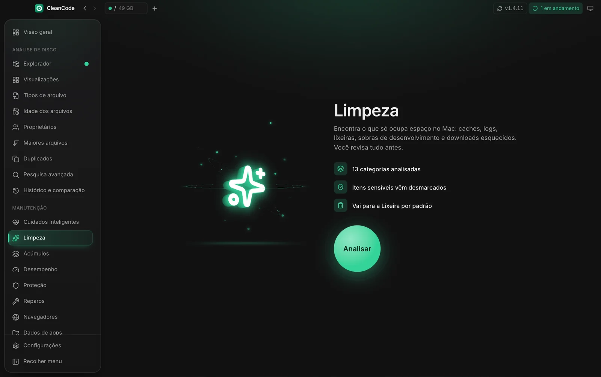<br /><strong>Limpieza</strong><br />Encuentra cachés, registros de actividad (logs), papeleras, restos de herramientas de desarrollo y descargas olvidadas. Revisas la lista antes de borrar cualquier cosa.</td>
    <td width="50%" valign="top">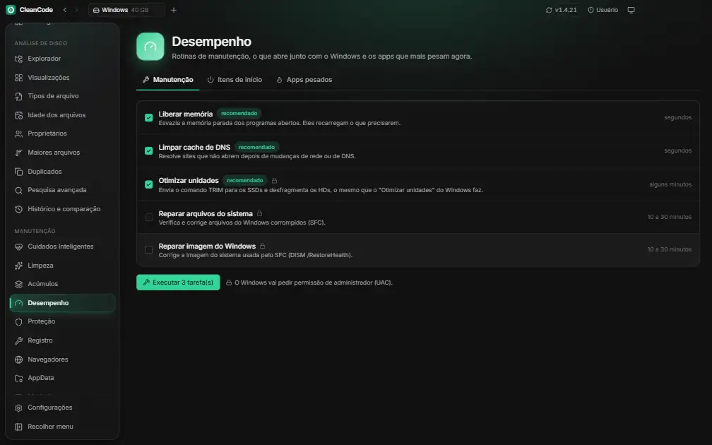<br /><strong>Rendimiento</strong><br />Ejecuta rutinas de mantenimiento del sistema y muestra los elementos que se abren junto con el ordenador. Además, muestra las apps que más recursos usan en este momento.</td>
  </tr>
  <tr>
    <td width="50%" valign="top">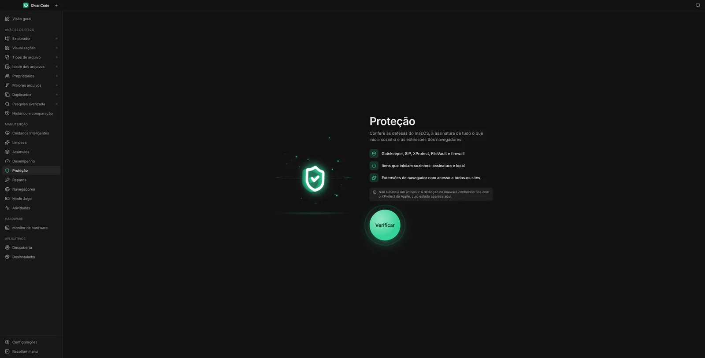<br /><strong>Protección</strong><br />Revisa si las defensas del sistema están activadas. También revisa la firma y la ubicación de todo lo que se inicia solo, y muestra las extensiones de navegador que tienen acceso a todos los sitios web.</td>
    <td width="50%" valign="top">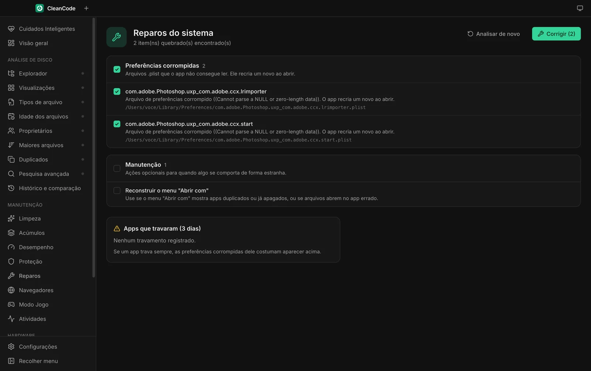<br /><strong>Registro de Windows y Reparaciones de macOS</strong><br />Muestra solo los elementos que están rotos de forma comprobada. En Windows, CleanCode guarda una copia del registro (un archivo <code>.reg</code>) antes de corregir. En el Mac, corrige preferencias dañadas y agentes que apuntan a apps borradas.</td>
  </tr>
  <tr>
    <td width="50%" valign="top">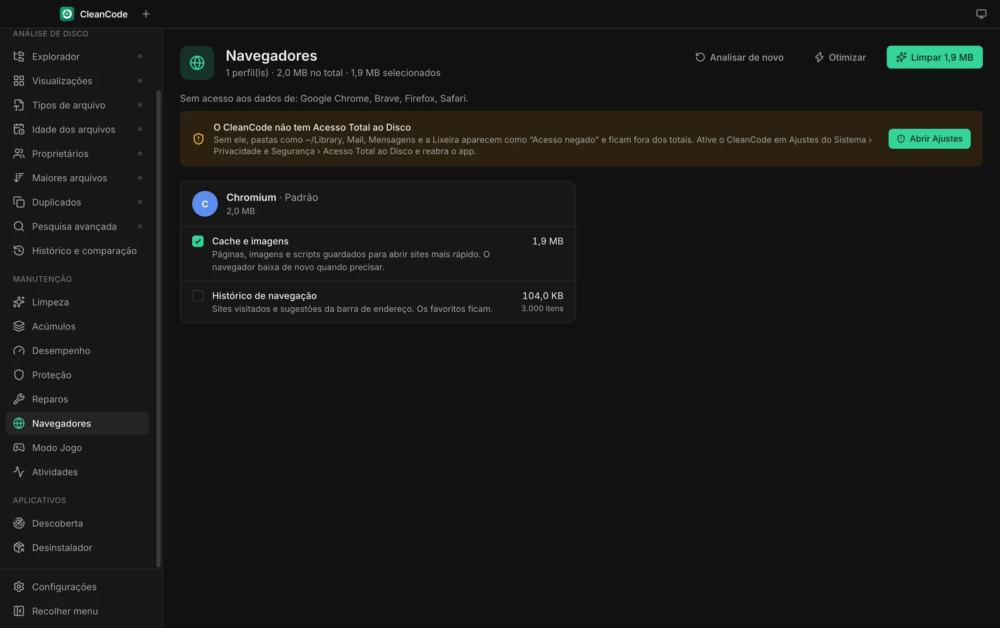<br /><strong>Navegadores</strong><br />Limpia la caché, el historial, las descargas, las cookies, las sesiones y el autocompletado de cada perfil. Además, compacta las bases de datos internas de los navegadores.</td>
    <td width="50%" valign="top">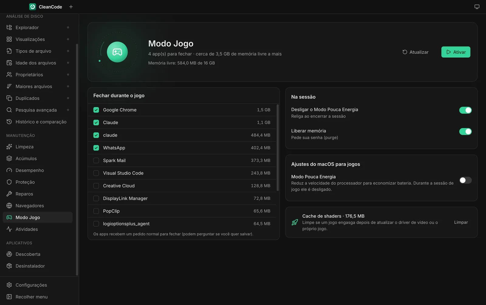<br /><strong>Modo Juego</strong><br />Cierra las apps pesadas, libera memoria y pone el sistema en el máximo rendimiento. Cuando terminas la sesión, CleanCode deja todo como estaba antes.</td>
  </tr>
</table>

### Monitor de hardware

<table>
  <tr>
    <td width="50%" valign="top">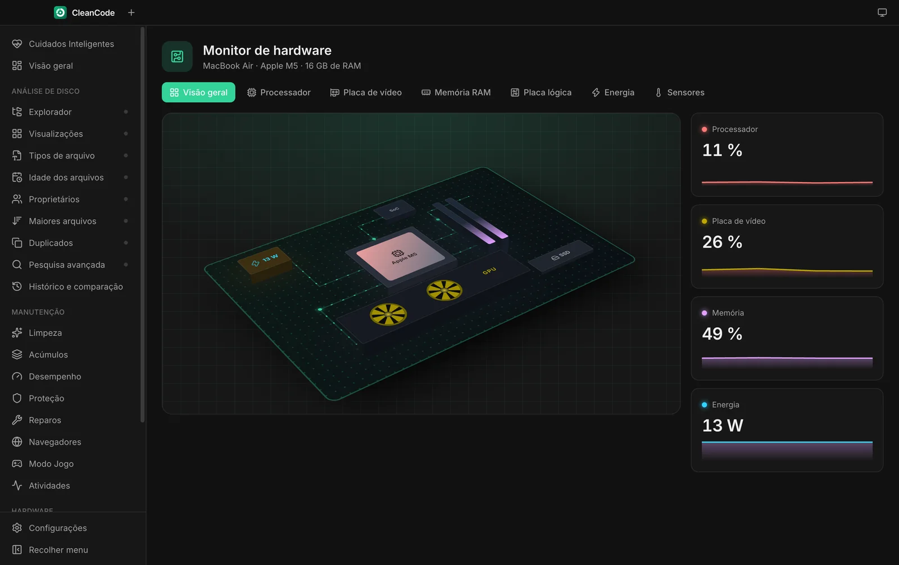<br /><strong>Visión general</strong><br />Muestra tu ordenador en 3D, ya sea un MacBook, un portátil o un PC de sobremesa. La cámara se mueve alrededor del modelo, y los números en vivo quedan al lado.</td>
    <td width="50%" valign="top">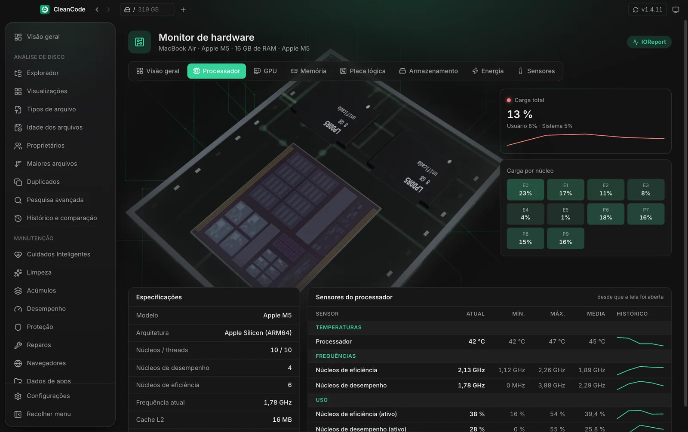<br /><strong>Procesador</strong><br />Cada núcleo se ilumina según su propia carga. La pantalla también muestra los núcleos de rendimiento y de eficiencia, la memoria caché y la temperatura.</td>
  </tr>
  <tr>
    <td width="50%" valign="top">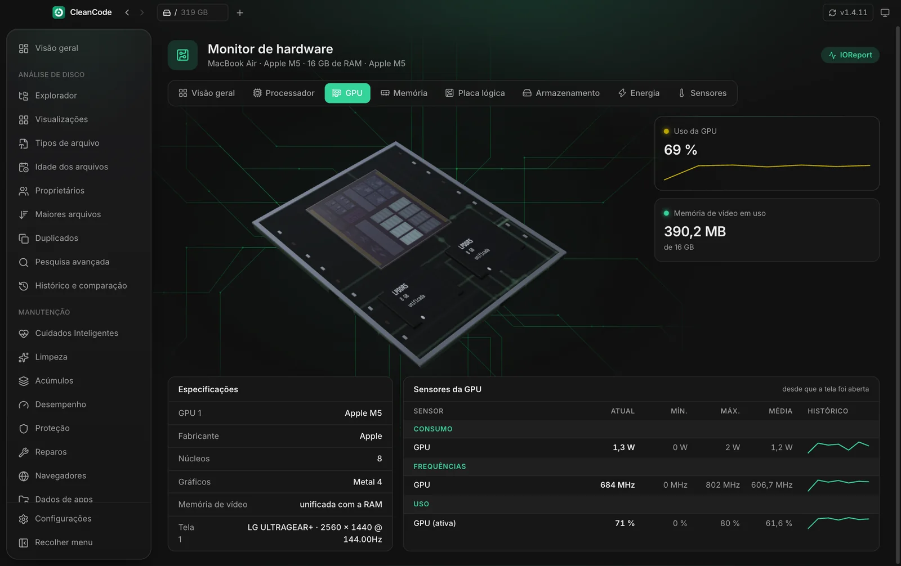<br /><strong>Tarjeta gráfica</strong><br />Muestra el uso de la tarjeta gráfica, la memoria de vídeo, el controlador, la temperatura y las pantallas conectadas. En un PC, los ventiladores del modelo 3D giran más rápido cuando el uso aumenta.</td>
    <td width="50%" valign="top">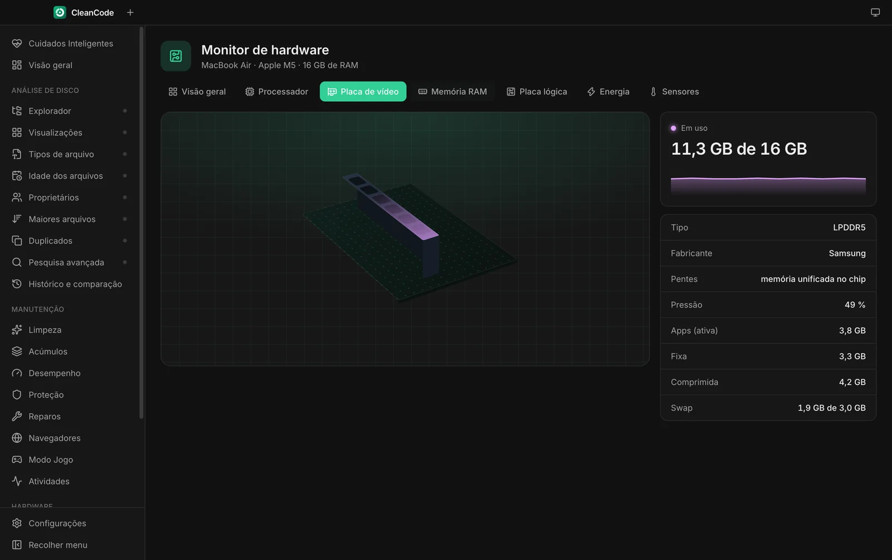<br /><strong>Memoria RAM</strong><br />Muestra el tipo, la velocidad y el fabricante de la memoria, además de las ranuras ocupadas. También muestra la presión de memoria y el uso del swap, que es la memoria extra guardada en el disco.</td>
  </tr>
  <tr>
    <td width="50%" valign="top">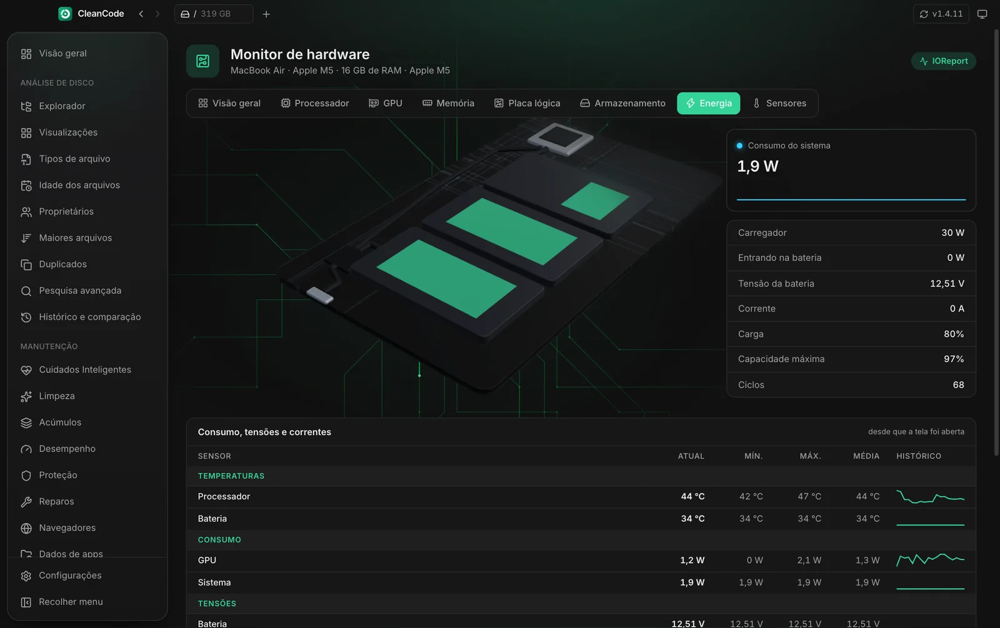<br /><strong>Energía</strong><br />Muestra cuántos vatios consume el ordenador y cuánta energía llega del cargador. También muestra el voltaje, la corriente y la salud de la batería.</td>
    <td width="50%" valign="top">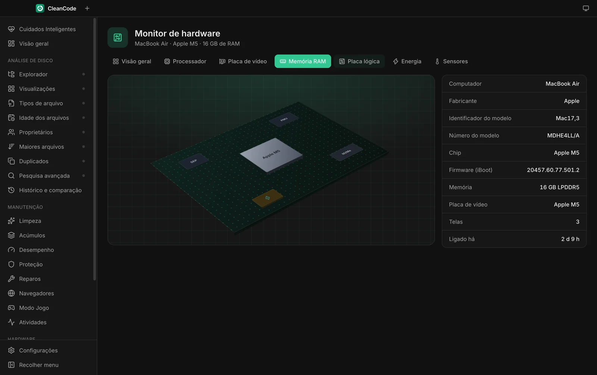<br /><strong>Placa base y placa lógica</strong><br />Muestra el modelo de la placa, el chip, la versión del firmware (o de la BIOS, en un PC) y los voltajes. En un PC, también muestra los ventiladores y los módulos de memoria instalados.</td>
  </tr>
  <tr>
    <td width="50%" valign="top">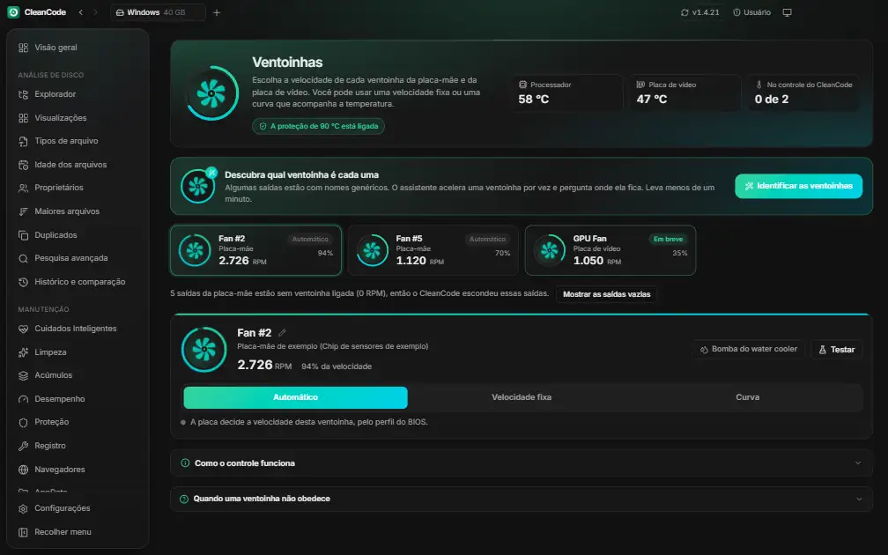<br /><strong>Ventiladores</strong><br />En Windows, eliges una velocidad fija o una curva de temperatura para cada ventilador de la placa base y de las tarjetas gráficas AMD. Un asistente descubre qué ventilador es cada uno, y cada ventilador vuelve al modo automático cuando cierras CleanCode.</td>
  </tr>
</table>

<details>
<summary><strong>Más pantallas: almacenamiento, sensores y desinstalador</strong></summary>
<br />
<table>
  <tr>
    <td width="50%" valign="top">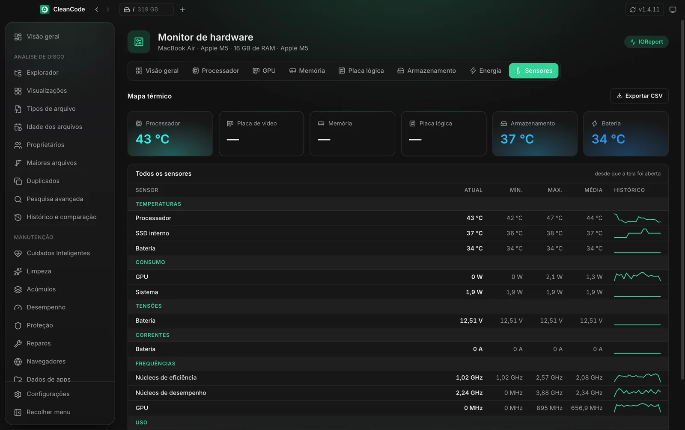<br /><strong>Sensores</strong><br />Muestra un mapa de temperaturas y una tabla con el valor actual, el mínimo, el máximo y el promedio de cada sensor. Puedes exportar la tabla a una hoja de cálculo (un archivo CSV).</td>
    <td width="50%" valign="top">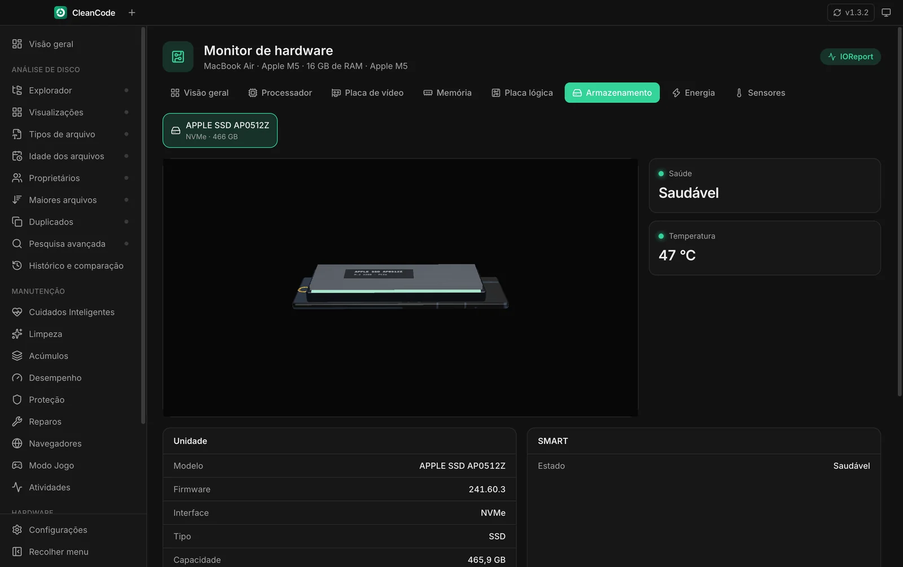<br /><strong>Almacenamiento</strong><br />Muestra cada disco en 3D, con el modelo, la versión del firmware, la interfaz, la salud, la temperatura y las particiones.</td>
  </tr>
  <tr>
    <td width="50%" valign="top">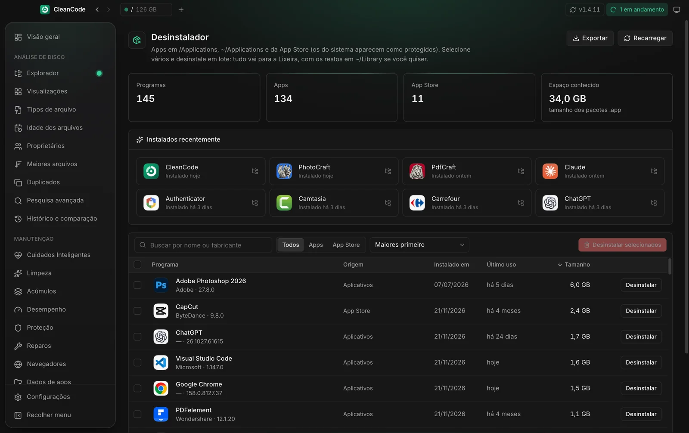<br /><strong>Desinstalador</strong><br />Elimina apps, paquetes de la tienda y los restos que dejan en <code>~/Library</code> (en el Mac) o en el registro (en Windows). Puedes eliminar varias apps a la vez, y todo va a la Papelera.</td>
  </tr>
</table>
</details>

### Panel de la barra de menús

<table>
  <tr>
    <td width="33%" valign="top"><br /><strong>Salud del ordenador</strong><br />Muestra el disco, la memoria, la batería, el procesador, la tarjeta gráfica, la energía, la red y los dispositivos conectados.</td>
    <td width="33%" valign="top">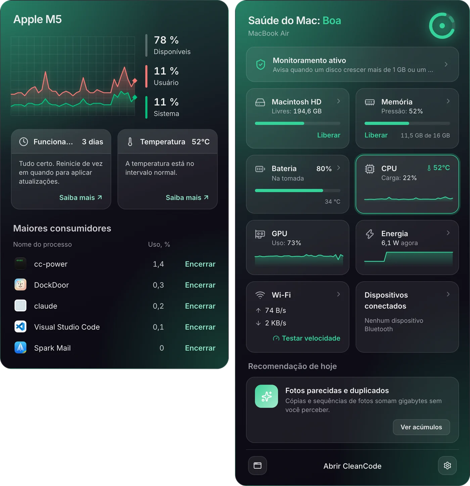<br /><strong>Procesador</strong><br />Muestra cuánto del procesador usan las apps y el sistema. También muestra la temperatura, el tiempo encendido y las apps que más usan el procesador.</td>
    <td width="33%" valign="top">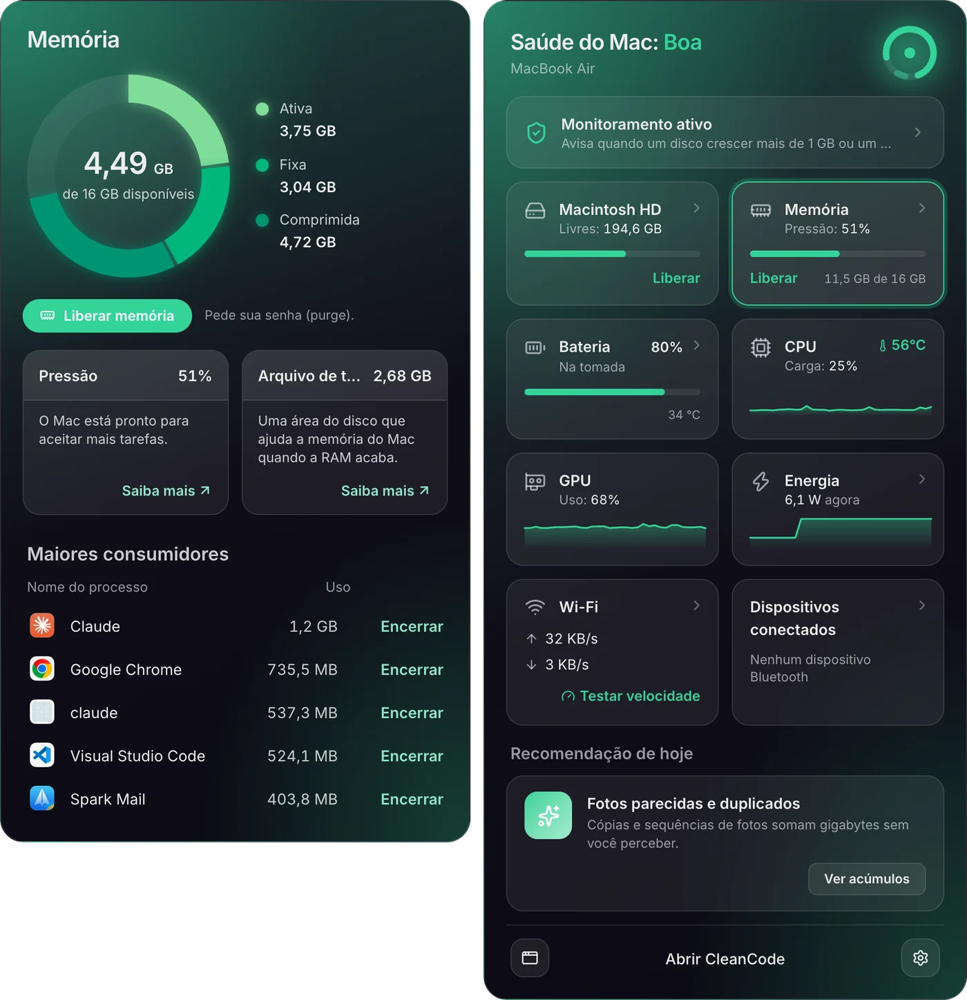<br /><strong>Memoria</strong><br />Muestra cómo se divide la memoria, la presión de memoria, el uso del swap y las apps que más memoria usan.</td>
  </tr>
  <tr>
    <td width="33%" valign="top">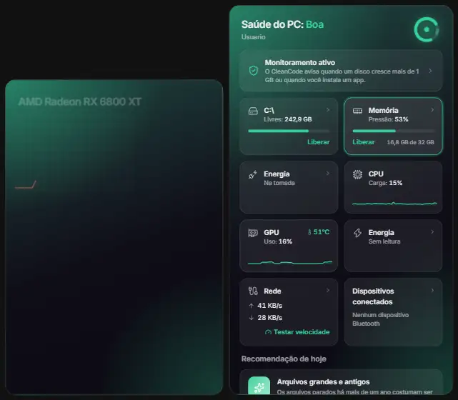<br /><strong>Tarjeta gráfica</strong><br />Muestra el uso en vivo, los núcleos, la memoria, las pantallas conectadas y la temperatura.</td>
    <td width="33%" valign="top">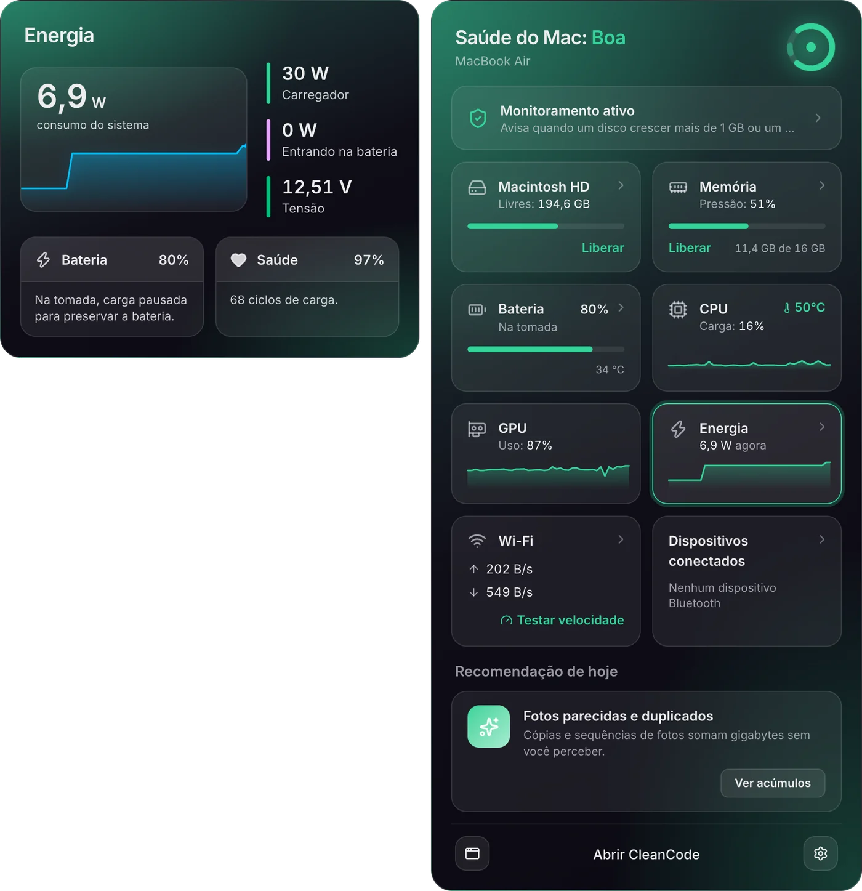<br /><strong>Energía</strong><br />Muestra el consumo del sistema en vatios, la potencia del cargador, la energía que entra en la batería y el voltaje.</td>
    <td width="33%" valign="top">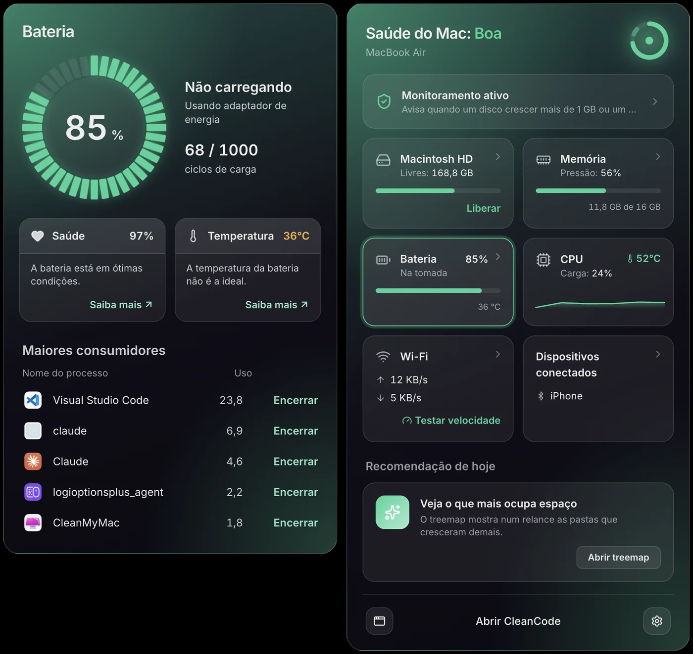<br /><strong>Batería</strong><br />Muestra la carga, el número de ciclos, la capacidad máxima y la temperatura de la batería.</td>
  </tr>
  <tr>
    <td width="33%" valign="top">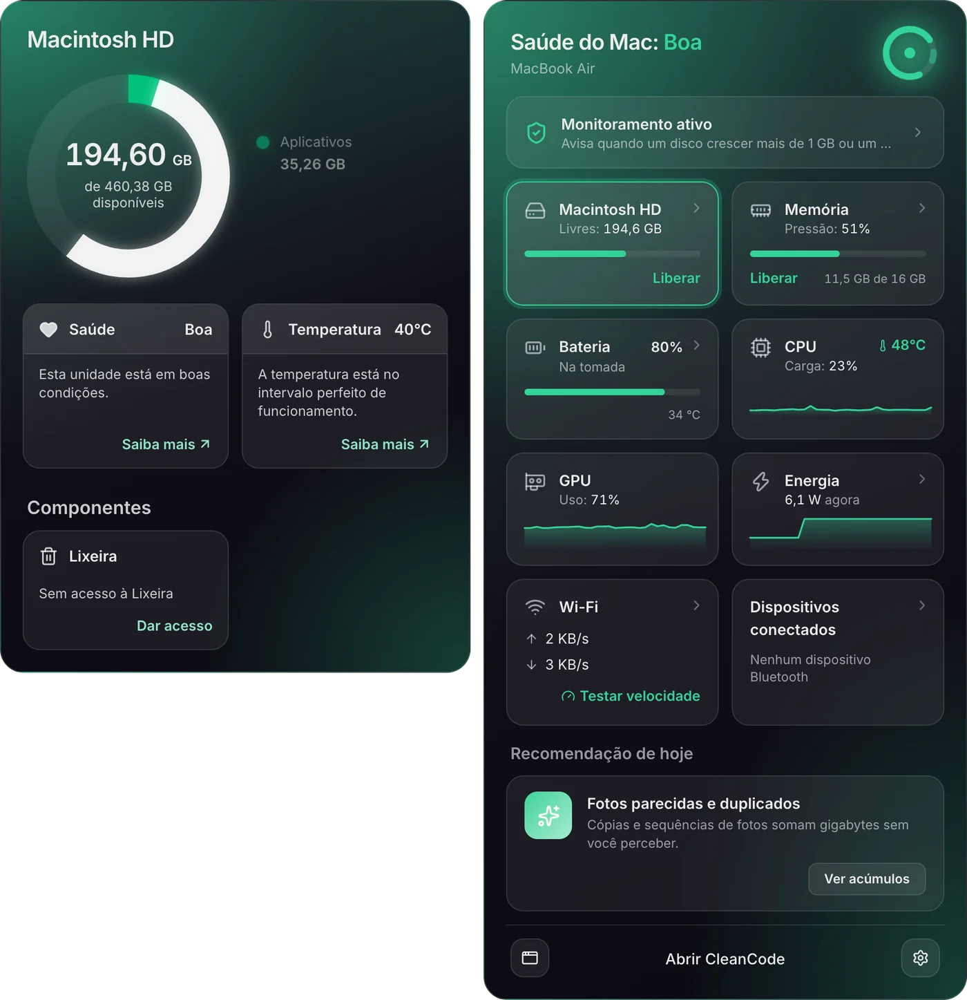<br /><strong>Almacenamiento</strong><br />Muestra lo que ocupa el disco, la salud del SSD y el tamaño de la Papelera.</td>
    <td width="33%" valign="top">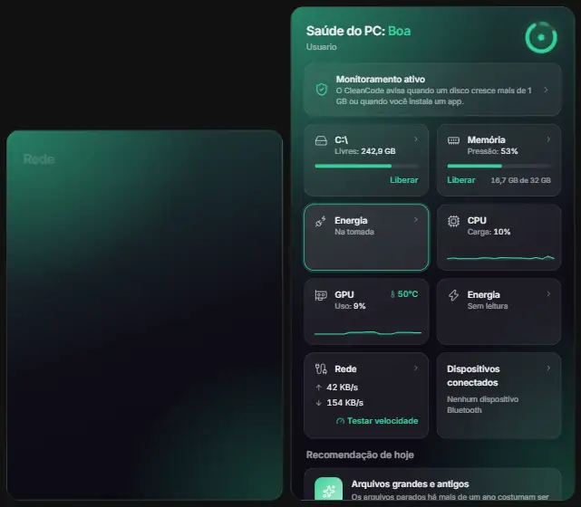<br /><strong>Red</strong><br />Muestra si tu Wi-Fi es seguro y cuántos datos descargaste y enviaste. Además, hace una prueba de velocidad de internet.</td>
    <td width="33%" valign="top"></td>
  </tr>
</table>

## Todo lo que hace CleanCode

<details open>
<summary><strong>Análisis de disco</strong></summary>

- **El escaneo es nativo y rápido.** En Windows, CleanCode lee las carpetas con la función del sistema `FindFirstFileExW`, mediante la biblioteca koffi, en un hilo separado. En macOS, usa `readdir` y `lstat` y calcula el espacio que cada archivo ocupa realmente en el disco.
- **El Explorador** muestra las carpetas en forma de árbol. Tú eliges las columnas, como el tamaño, el espacio asignado, la cantidad de archivos, el porcentaje y la fecha.
- **Las Visualizaciones** muestran la misma carpeta de tres formas:
  - un mapa de bloques (treemap) con relieve, niveles de detalle, etiquetas y jerarquía;
  - un gráfico circular;
  - un gráfico de barras.
- **Otras pantallas de análisis** muestran los tipos de archivo, la antigüedad de los archivos, los propietarios de los archivos, los archivos más grandes y los archivos duplicados. Los duplicados se confirman por su contenido, y no solo por su nombre.
- **La Búsqueda avanzada** filtra archivos por nombre, tamaño, fecha y tipo.
- **El Historial y comparación** muestra lo que creció desde el último análisis.
- Puedes exportar los resultados a una hoja de cálculo. Además, el menú del clic derecho te permite abrir el archivo, mostrarlo en el Finder o en el Explorador de archivos y ver sus propiedades.

</details>

<details open>
<summary><strong>Mantenimiento</strong></summary>

- **Cuidados Inteligentes** hace la limpieza, la revisión de protección, la revisión de rendimiento y la búsqueda de apps olvidadas en un único análisis.
- **Limpieza**:
  - encuentra las cachés del sistema y de las apps, los registros de actividad (logs), la Papelera, los restos de herramientas de desarrollo (como Xcode, npm y Gradle) y las descargas antiguas;
  - deja los elementos sensibles desmarcados y, por defecto, envía todo a la Papelera.
- **Acumulaciones** encuentra archivos grandes y antiguos, archivos duplicados, fotos parecidas y lo que quedó olvidado en la carpeta de Descargas. Para encontrar fotos parecidas, CleanCode compara el aspecto de las imágenes.
- **Rendimiento**:
  - libera memoria;
  - limpia la caché de DNS, que guarda las direcciones de los sitios web;
  - reduce las instantáneas locales de Time Machine;
  - ejecuta los scripts de mantenimiento de macOS y rehace el índice de Spotlight;
  - activa y desactiva los elementos que se abren junto con el ordenador;
  - muestra las apps que más recursos usan.
- **Protección**:
  - en el Mac, revisa Gatekeeper, SIP, XProtect, FileVault y el firewall; en Windows, revisa Defender, UAC, SmartScreen y el firewall;
  - revisa la firma y la ubicación de todo lo que se inicia solo;
  - muestra las extensiones de navegador que tienen acceso a todos los sitios web.
- **Registro de Windows y Reparaciones de macOS**:
  - **En Windows**, CleanCode encuentra estos problemas:
    - elementos de inicio que apuntan a un programa eliminado;
    - programas fantasma, que aparecen en la lista de programas instalados pero ya fueron eliminados;
    - rutas de apps (App Paths) rotas;
    - entradas rotas en el menú "Abrir con" y en el menú del clic derecho;
    - entradas antiguas en MuiCache;
    - accesos directos rotos;
    - servicios huérfanos, que CleanCode solo muestra y no modifica.

    Antes de cada cambio, CleanCode guarda una copia del registro en un archivo `.reg`. Si algo sale mal, restauras la copia en la misma pantalla.
  - **En macOS**, CleanCode corrige preferencias dañadas (archivos `.plist`), agentes de inicio que apuntan a apps borradas y enlaces rotos. También rehace el menú "Abrir con".
  - La pantalla muestra las apps que se cerraron por error en los últimos 3 días.
  - Cuando aparece un elemento roto nuevo, CleanCode te avisa, incluso con la ventana cerrada.
- **Navegadores**:
  - funciona con Chrome, Edge, Brave, Opera, Opera GX, Vivaldi, Chromium, Firefox y Safari, y separa cada perfil;
  - limpia la caché y las imágenes, los datos de la tarjeta gráfica, el historial, el historial de descargas, las cookies y los datos de sitios, las sesiones y el autocompletado;
  - compacta las bases de datos internas de los navegadores con el comando `VACUUM`, lo que hace que esos archivos sean más pequeños;
  - te pide que cierres el navegador antes de la limpieza y nunca lo cierra a la fuerza.
- **Datos de apps (AppData)**:
  - muestra el tamaño de cada carpeta que los programas guardan en tu perfil (en Windows, `Local`, `Roaming` y `LocalLow`; en el Mac, `Application Support` y `Caches`);
  - limpia de forma segura las cachés, los registros de actividad, los informes de errores y las versiones antiguas que las actualizaciones dejan atrás;
  - encuentra los restos de programas desinstalados y los envía a la Papelera.
- **Liberar memoria** está disponible en el panel, en la pestaña Memoria y en el menú del icono.
- **Modo Juego**:
  - durante la sesión, cierra las apps en segundo plano y libera memoria;
  - en Windows, activa el plan de energía de alto rendimiento; en el Mac, desactiva el modo de bajo consumo;
  - da prioridad alta al juego;
  - cuando terminas la sesión, deja todo como estaba antes;
  - en Windows, también ajusta el Modo de juego, la grabación de Xbox y la programación de la tarjeta gráfica;
  - limpia las cachés de shaders de DirectX, NVIDIA, AMD, Intel y Metal, que pueden crecer mucho con el tiempo;
  - encuentra solo los juegos de Steam, Epic y GOG, y puedes añadir otras carpetas de juegos.
- **Actividades** muestra el historial de todo lo que hizo CleanCode y cuánto espacio liberó cada acción.

</details>

<details open>
<summary><strong>Monitor de hardware</strong></summary>

- **Procesador**:
  - muestra el modelo, la arquitectura, la cantidad de núcleos y de hilos, y la división entre núcleos de rendimiento y núcleos de eficiencia;
  - muestra la frecuencia, la memoria caché (L2 y L3) y la temperatura;
  - muestra la carga total, la carga de las apps, la carga del sistema y la carga de cada núcleo.
- **Tarjeta gráfica**:
  - muestra el modelo, el fabricante, los núcleos, la tecnología gráfica (Metal o DirectX), el controlador, la memoria de vídeo y la temperatura;
  - muestra las pantallas conectadas;
  - en Windows, muestra los programas que más usan la tarjeta gráfica.
- **Memoria RAM**: muestra el tipo (por ejemplo, DDR4, DDR5 o LPDDR5), la velocidad, el fabricante, los módulos y las ranuras. También muestra cómo se divide la memoria, la presión de memoria y el uso del swap.
- **Placa base y placa lógica**: muestra el fabricante, el modelo, la revisión, el chip, la versión de la BIOS o del firmware y la fecha de esa versión.
- **Energía**: muestra el consumo del sistema en vatios, la potencia del cargador, la energía que entra o sale de la batería, el voltaje, la corriente, los ciclos y la salud de la batería.
- **Almacenamiento**: muestra cada disco con el modelo, el firmware, la interfaz, la velocidad de conexión, el soporte de TRIM, la salud, la temperatura, las horas de uso, los datos escritos y leídos, y las particiones.
- **Sensores**: muestra una tabla por pieza con el valor actual, el mínimo, el máximo, el promedio y un pequeño gráfico de cada sensor. También muestra un mapa de temperaturas, y puedes exportarlo todo a un archivo CSV.
  - **En Windows**, CleanCode usa **LibreHardwareMonitor**. Cuando activas el monitoreo avanzado, que instala el controlador firmado PawnIO, CleanCode también lee la temperatura y la frecuencia de cada núcleo, los voltajes, los ventiladores de la placa base, el consumo y los datos SMART de los discos.
  - **En el Mac**, CleanCode lee la frecuencia y la actividad de los núcleos y de la tarjeta gráfica, además del consumo de energía. Para hacerlo, usa el IOReport del sistema y no pide contraseña.
- **Modelos 3D (hechos con three.js)**:
  - cada pieza tiene un modelo 3D con acabado mate: tarjeta gráfica, procesador, memoria, placa base, SSD y energía;
  - en la visión general, el modelo es tu propio ordenador: un PC con caja de cristal, un MacBook o un portátil con Windows;
  - la cámara se mueve sola alrededor del modelo, y aparecen circuitos animados en el fondo.
- **Ventiladores (Windows)**:
  - eliges, para cada ventilador que acepta control, el modo automático, una velocidad fija o una curva que sigue una temperatura;
  - si el procesador o la tarjeta gráfica llega a 90 °C, los ventiladores controlados pasan al 100% hasta que la temperatura baja a 85 °C;
  - después de cada comando, CleanCode comprueba el valor y las RPM que informa la placa, y devuelve el ventilador al modo automático cuando no obedece;
  - el asistente "Identificar los ventiladores" acelera un ventilador por vez y pregunta dónde está, y una guía explica qué hacer cuando un ventilador no obedece;
  - en las tarjetas gráficas AMD (RX 5000 y más nuevas), CleanCode controla el ventilador por el controlador de AMD (ADLX), y devuelve la curva del controlador y el Zero RPM cuando vuelves al modo automático;
  - las tarjetas gráficas NVIDIA e Intel por ahora solo muestran la velocidad del ventilador, y su control llega en una próxima versión.

</details>

<details open>
<summary><strong>Apps</strong></summary>

- **Desinstalador**:
  - encuentra las apps en `/Applications` y en `~/Applications` en el Mac, y los programas y los paquetes de Microsoft Store en Windows;
  - encuentra los restos de las apps en `~/Library` (en el Mac) o en el registro (en Windows);
  - elimina varias apps a la vez y envía todo a la Papelera.
- **Ficha de la app**: cada app tiene su propia pantalla. Esa pantalla muestra quién creó la app, la licencia, la versión, la fecha de instalación, el espacio ocupado y las carpetas de datos de la app.
- **Descubrimiento** muestra las apps que no abres desde hace meses y cuánto espacio liberarían.
- **Aviso de instalación**: cuando instalas una app, CleanCode te avisa cuánto espacio ocupó.

</details>

<details open>
<summary><strong>Panel de la barra de menús y de la bandeja</strong></summary>

- El panel se abre en la esquina de la pantalla. En el Mac, aparece en la esquina superior derecha. En Windows, aparece en la esquina inferior derecha.
- El panel tiene tarjetas de disco, memoria, batería, procesador, tarjeta gráfica, energía, red y dispositivos. Cuando haces clic en una tarjeta, el detalle se abre al lado.
- La **prueba de velocidad** mide la latencia, la velocidad de descarga y la velocidad de subida de tu internet.
- El panel también expulsa discos externos, muestra la batería de los dispositivos Bluetooth y hace una recomendación por día.
- Los colores siguen el color de acento que elegiste en la app, tanto en el tema claro como en el tema oscuro.

</details>

<details open>
<summary><strong>Segundo plano y actualizaciones</strong></summary>

- CleanCode se queda en la barra de menús (en el Mac) o en la bandeja del sistema (en Windows). Desde ahí, te avisa cuando un disco crece por encima del límite, cuando se instala una app o cuando aparece un elemento roto.
- **Actualizaciones**: CleanCode busca versiones nuevas cada 3 minutos y también cuando el ordenador sale del reposo. Cuando encuentra una versión nueva, muestra un aviso en el centro de la pantalla con las novedades.
  - Si haces clic en **Actualizar ahora** (en portugués, "Atualizar agora"), el aviso muestra la descarga y cada etapa de la instalación. CleanCode solo se reinicia cuando la instalación termina.
  - Si prefieres actualizar más tarde, CleanCode descarga la versión nueva solo y la instala cuando cierras la ventana.
  - En todos los casos, CleanCode descarga solo el archivo hecho para tu ordenador y comprueba el código SHA-512 del archivo antes de instalar.
- La primera vez que abres CleanCode después de una actualización, muestra una ventana con **las novedades de esa versión**.

</details>

## Seguridad y privacidad

| CleanCode… | Cómo lo hace |
|---|---|
| **Nunca borra nada sin mostrarlo antes** | Cada eliminación pasa por una lista que tú revisas. Además, CleanCode solo borra rutas que aparecieron en el último análisis. |
| **Prefiere la Papelera** | Los archivos, las apps y los accesos directos van a la Papelera. CleanCode solo borra de forma definitiva los archivos de caché y los elementos que tú elijas. |
| **Hace una copia del registro** | Antes de cambiar una clave del registro, CleanCode guarda la clave en un archivo `.reg`. Restauras la copia en la misma pantalla. |
| **Conserva contraseñas y marcadores** | CleanCode nunca toca los archivos de contraseñas, marcadores, tarjetas y direcciones de los navegadores, como `Login Data`, `Bookmarks`, `logins.json` y `key4.db`. |
| **Pide permiso cuando lo necesita** | Las acciones de administrador muestran la solicitud del propio sistema, es decir, la contraseña de macOS o la ventana del UAC en Windows. |
| **No recopila datos** | CleanCode no tiene cuenta ni telemetría. Solo se conecta a internet para buscar actualizaciones en GitHub y para hacer la prueba de velocidad en Cloudflare, cuando tú lo pides. |

## Descarga e instalación

Descarga la versión más reciente en la página **[Releases](https://github.com/marquessrafa/cleancode/releases/latest)**:

| Sistema | Archivo |
|---|---|
| macOS 12 o más reciente, con Apple Silicon (M1, M2, M3, M4 o M5) | `CleanCode-<versión>-macOS-Apple-Silicon.dmg` |
| macOS 12 o más reciente, con procesador Intel | `CleanCode-<versión>-macOS-Intel.dmg` |
| Windows 10 u 11, de 64 bits | `CleanCode-<versión>-Windows-x64.exe` |

**En macOS:**

1. Abre el archivo `.dmg` y arrastra CleanCode a la carpeta Aplicaciones.
2. La app tiene una firma propia, porque no usa una cuenta de desarrollador de Apple de pago. Por eso, la primera vez que la abras, haz clic derecho en la app y elige **Abrir**. Otra opción es ir a Ajustes del Sistema, después a Privacidad y seguridad, y hacer clic en **Abrir igualmente**.
3. Para que CleanCode pueda analizar todas las carpetas, dale **Acceso total al disco** en Privacidad y seguridad. La app te avisa cuando falta este permiso y abre el panel correcto para ti.

**En Windows:**

1. Abre el instalador.
2. El instalador no tiene un certificado de firma de pago, así que SmartScreen puede mostrar un aviso. En ese caso, haz clic en **Más información** y después en **Ejecutar de todas formas**.

> Los archivos `.zip` de macOS y los archivos `latest*.yml` de la página Releases los usa el actualizador de la app. No necesitas descargar esos archivos.

## Cómo funciona CleanCode por dentro

| Capa | Tecnología |
|---|---|
| Interfaz | React 19, Tailwind CSS 4, Vite 8 e iconos Lucide. |
| App | Electron 45 con Node 24. El proceso principal se comunica con las ventanas mediante un preload con `contextBridge`, y las ventanas están aisladas (`sandbox` y `contextIsolation`). |
| Sistema operativo | La carpeta `electron/platform/` tiene las mismas funciones para cada sistema, separadas en `darwin/` (macOS) y `win32/` (Windows). |
| Windows | Llamadas directas a las funciones de Windows con la biblioteca [koffi](https://koffi.dev) (por ejemplo, `FindFirstFileExW` y `GetCompressedFileSizeW`), además de PowerShell, CIM, `reg.exe` y contadores de rendimiento. |
| macOS | Herramientas del sistema, como `diskutil`, `system_profiler`, `ioreg`, `launchctl`, `pmset`, `plutil`, `codesign` y `spctl`. Los sensores se leen con un programa propio escrito en C (`cc-sensors`). |
| Datos de los navegadores | El módulo `node:sqlite` (`DatabaseSync`), que ya viene con Node 24. |
| 3D | [three.js](https://threejs.org) con modelos propios, acabado mate y una cámara que se mueve sola. |
| Sensores | En Windows, [LibreHardwareMonitor](https://github.com/LibreHardwareMonitor/LibreHardwareMonitor) (mediante un programa auxiliar en C#) y, si lo quieres, el controlador [PawnIO](https://pawnio.eu). En macOS, IOReport (`cc-power`) e IOHID (`cc-sensors`). |
| Trabajo pesado | El escaneo, el cálculo de tamaños, la limpieza y las acumulaciones se ejecutan en `worker_threads`, así que la interfaz no se congela. |
| Compilación y distribución | electron-builder crea los instaladores (NSIS, DMG y ZIP). GitHub Actions compila los dos sistemas y publica un canal de actualizaciones con una entrada por arquitectura y con la verificación SHA-512. |

Estas son las carpetas principales del proyecto:

```
electron/            proceso principal, comunicación entre ventanas, workers y actualizador
electron/platform/   todo lo que se comunica con el sistema operativo (darwin/ y win32/)
native/macos/        programa auxiliar que lee los sensores en el Mac (escrito en C)
src/pages/           pantallas de la app
src/panel/           panel de la barra de menús y de la bandeja
release-notes/       notas técnicas de cada versión
docs/                guía de desarrollo, traducciones del README y capturas de pantalla
```

## Cómo compilar desde el código

Necesitas Node.js 22 o más reciente y npm. En macOS, también necesitas las Command Line Tools de Xcode, porque compilan el programa que lee los sensores.

```bash
git clone https://github.com/marquessrafa/cleancode.git
```

```bash
cd cleancode && npm install
```

```bash
npm start
```

Para crear los instaladores, usa uno de estos comandos:

```bash
npm run dist:mac
```

```bash
npm run dist
```

- El comando `npm run dist:mac` se ejecuta en el Mac y crea los archivos `.dmg` y `.zip` para Apple Silicon y para Intel.
- El comando `npm run dist` se ejecuta en Windows y crea el instalador de 64 bits.
- Cuando creas una etiqueta con el formato `vX.Y.Z`, GitHub Actions compila los dos sistemas y publica la versión con las notas del archivo `release-notes/<versión>.md`.

La guía [docs/DESENVOLVIMENTO.md](../DESENVOLVIMENTO.md) tiene más detalles. Esta guía está escrita en portugués.

## Inspiración

CleanCode empezó como un analizador de disco para Windows inspirado en **TreeSize**, de JAM Software. Esa primera versión ya tenía el escaneo rápido, el árbol de carpetas, el treemap y las pantallas de tipos, de antigüedad, de propietarios y de duplicados. Después, cuando llegó a macOS, CleanCode ganó las áreas de mantenimiento y el panel de la barra de menús, inspirados en **CleanMyMac**, de MacPaw. A partir de ahí, llegaron funciones propias, como el monitor de hardware en 3D, el Modo Juego y las reparaciones del registro.

CleanCode es un proyecto independiente, con diseño y código propios. No tiene relación con JAM Software ni con MacPaw, y no usa código, imágenes ni recursos de otros productos. Los nombres mencionados pertenecen a sus dueños.

## Licencia

CleanCode usa la licencia [MIT](../../LICENSE). Esto significa que puedes usar, estudiar, modificar y compartir el código libremente.

La app usa estas bibliotecas de terceros: three.js (licencia MIT) y LibreHardwareMonitorLib (licencia MPL 2.0). El controlador PawnIO (licencia GPL-2.0) no viene con CleanCode. Se descarga del sitio oficial y se instala por separado, y solo cuando activas el monitoreo avanzado.

TechPowerUp cedió las fotos de las tarjetas gráficas que aparecen en la pantalla Ventiladores, y CleanCode usa esas fotos con permiso. AMD, Radeon, NVIDIA, GeForce, Intel y Arc son marcas de las empresas que son sus dueñas. CleanCode no tiene relación con estas empresas.
