<div align="center">

<h1> CleanCode</h1>

<!-- README_LANGUAGES_START -->
<p><sub><a href="../../README.md" lang="en">🇬🇧 English</a> · <a href="README_ES.md" lang="es">🇪🇸 Español</a> · <strong lang="pt-BR">🇧🇷 Português (Brasil)</strong></sub></p>
<!-- README_LANGUAGES_END -->

<h3>Limpeza, desempenho, proteção e monitor de hardware para macOS e Windows</h3>

<p>O CleanCode mostra para onde foi o espaço do seu disco e ajuda você a apagar o que não serve mais.<br />Além disso, ele corrige itens quebrados do sistema e mostra o uso do processador, da placa de vídeo, da memória e da energia em tempo real.</p>

<p>
  <a href="https://github.com/marquessrafa/cleancode/releases/latest"></a>
  <a href="https://github.com/marquessrafa/cleancode/releases"></a>
  <a href="../../LICENSE"></a>
  
  
  <a href="https://github.com/marquessrafa/cleancode/actions/workflows/release.yml"></a>
</p>

<p>
  <a href="https://github.com/marquessrafa/cleancode/releases/latest"></a>
  <a href="https://github.com/marquessrafa/cleancode/releases/latest"></a>
  <a href="https://github.com/marquessrafa/cleancode/releases/latest"></a>
</p>

</div>

<p align="center">
  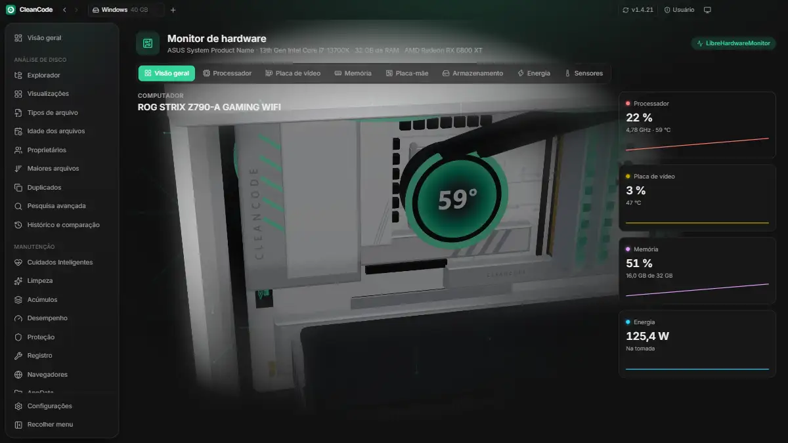
</p>

---

## Sumário

- [O que é o CleanCode](#o-que-é-o-cleancode)
- [Funcionalidades em imagens](#funcionalidades-em-imagens)
- [Tudo o que o CleanCode faz](#tudo-o-que-o-cleancode-faz)
- [Segurança e privacidade](#segurança-e-privacidade)
- [Download e instalação](#download-e-instalação)
- [Como o CleanCode funciona por dentro](#como-o-cleancode-funciona-por-dentro)
- [Como compilar a partir do código](#como-compilar-a-partir-do-código)
- [Inspiração](#inspiração)
- [Licença](#licença)

## O que é o CleanCode

O **CleanCode** é um app de manutenção para **macOS e Windows**. Ele junta, num só lugar, cinco grupos de ferramentas:

- A **análise de disco** mostra quais pastas e quais tipos de arquivo ocupam mais espaço. Ela também encontra arquivos antigos, arquivos duplicados e o que cresceu desde a última análise.
- A **manutenção** limpa arquivos que sobram, mostra o que inicia junto com o sistema, confere as proteções do sistema e corrige itens quebrados. Ela também limpa os navegadores e prepara o computador para jogos.
- Os **aplicativos** são desinstalados por completo, com as sobras que eles deixam no sistema. Além disso, o CleanCode avisa quais apps você não abre há meses.
- O **monitor de hardware** mostra cada peça do computador em 3D. Os modelos reagem aos dados reais do processador, da placa de vídeo, da memória e da energia.
- O **painel da barra de menus** (no macOS) ou da **bandeja** (no Windows) mostra a saúde do computador em tempo real, com um clique.

O CleanCode foi feito para ser **seguro desde o início**:

- Os arquivos apagados vão para a Lixeira, então você consegue recuperar tudo.
- Antes de mudar o registro do Windows, o CleanCode faz uma cópia de segurança.
- O CleanCode nunca apaga as senhas e os favoritos dos navegadores.
- O CleanCode não remove nada sem mostrar a lista para você antes.

> A interface do app está em português do Brasil.

## Funcionalidades em imagens

### Análise de disco

<table>
  <tr>
    <td width="50%" valign="top">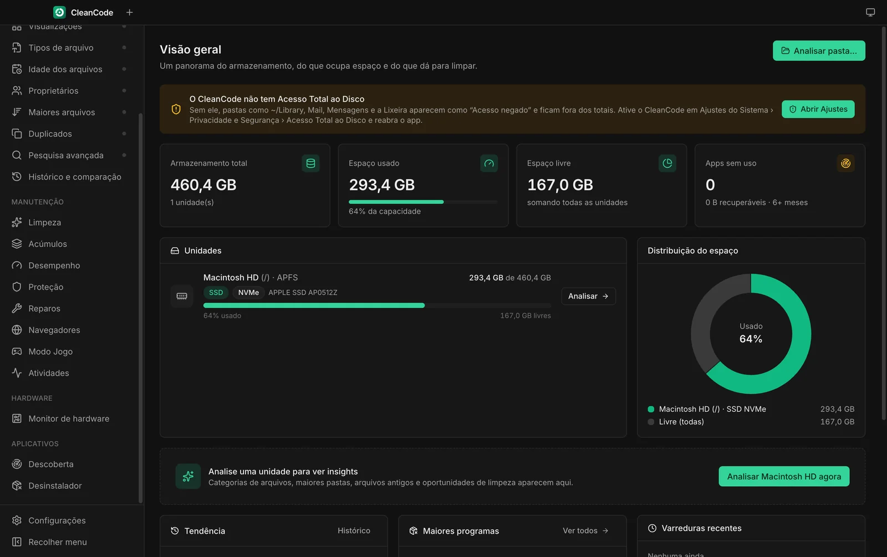<br /><strong>Visão geral</strong><br />Mostra cada disco com o espaço usado e o espaço livre. Logo abaixo, o mapa do armazenamento mostra quanto ocupam os apps, os documentos, os downloads, os caches e o sistema.</td>
    <td width="50%" valign="top">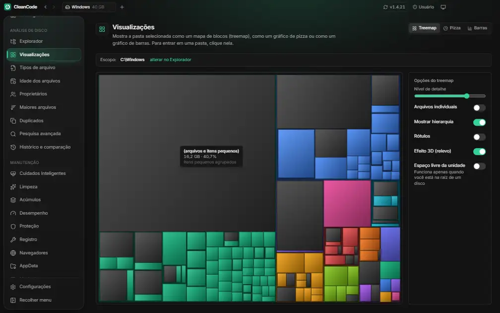<br /><strong>Visualizações</strong><br />Mostra as pastas em um mapa de blocos (treemap), em um gráfico de pizza ou em um gráfico de barras. Assim, você encontra as pastas mais pesadas com uma olhada.</td>
  </tr>
  <tr>
    <td width="50%" valign="top">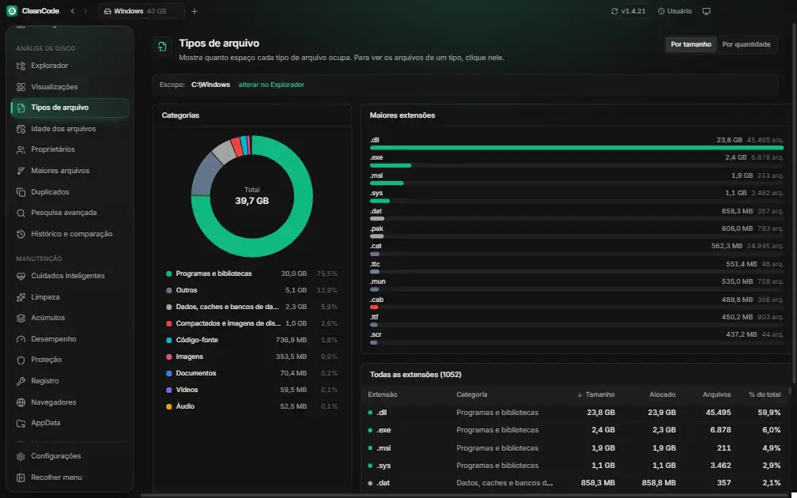<br /><strong>Tipos de arquivo</strong><br />Mostra quanto espaço cada tipo de arquivo ocupa, como vídeos, imagens e instaladores. Quando você clica em um tipo, o CleanCode lista os arquivos dele.</td>
    <td width="50%" valign="top">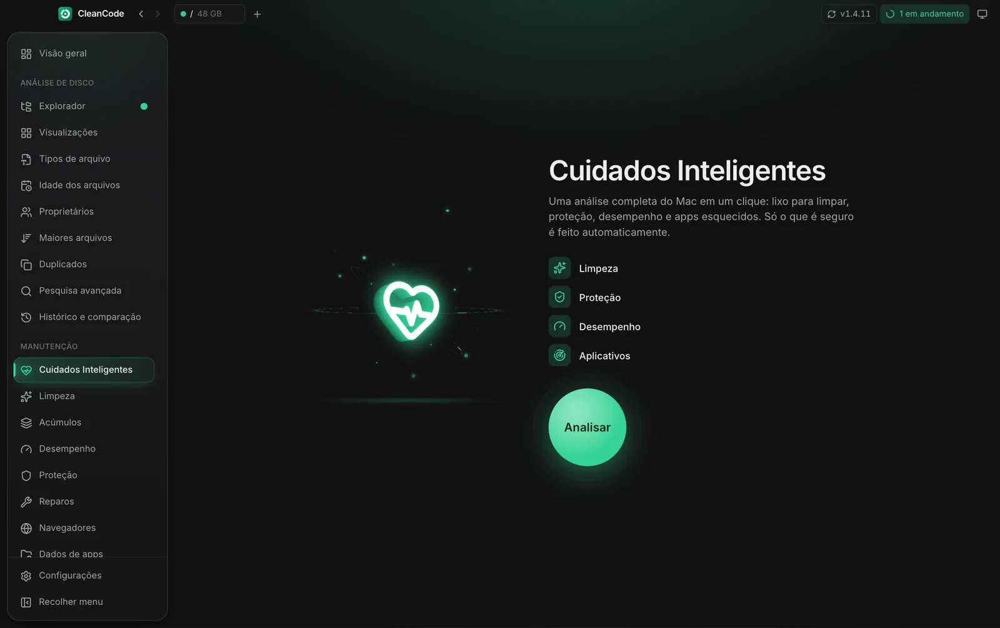<br /><strong>Cuidados Inteligentes</strong><br />Faz a limpeza, a verificação de proteção, a verificação de desempenho e a busca de apps esquecidos em uma única análise. Depois, você aplica as ações seguras com um clique.</td>
  </tr>
</table>

### Manutenção

<table>
  <tr>
    <td width="50%" valign="top">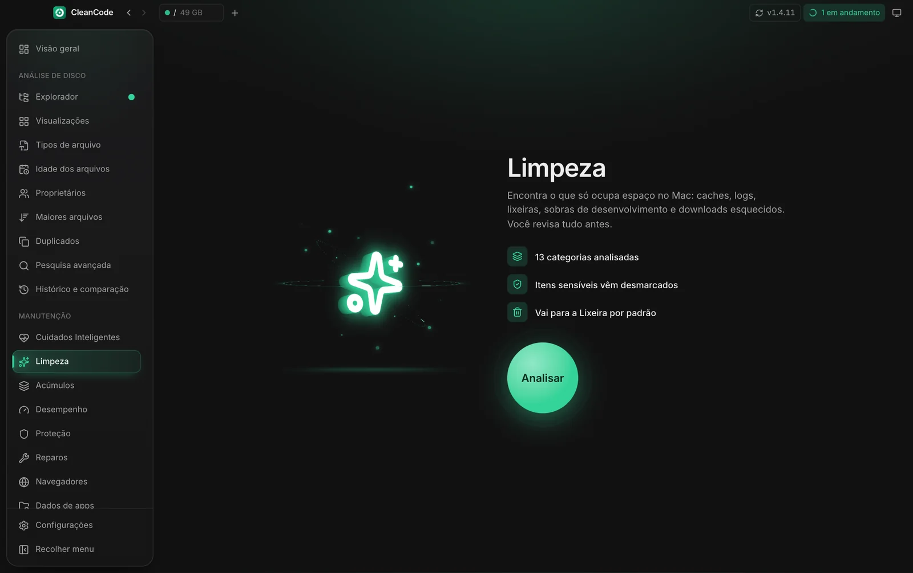<br /><strong>Limpeza</strong><br />Encontra caches, registros de atividade (logs), lixeiras, sobras de ferramentas de desenvolvimento e downloads esquecidos. Você revisa a lista antes de apagar qualquer coisa.</td>
    <td width="50%" valign="top">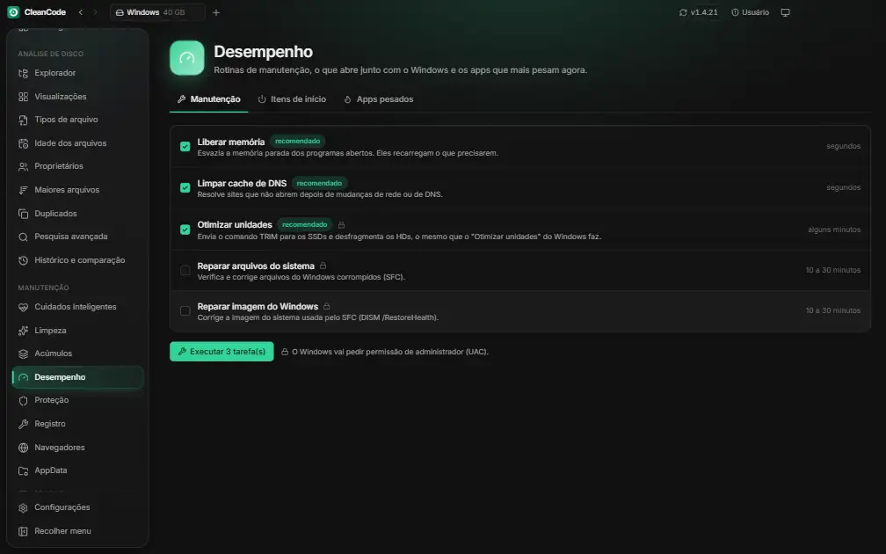<br /><strong>Desempenho</strong><br />Executa rotinas de manutenção do sistema e mostra os itens que abrem junto com o computador. Além disso, mostra os apps que mais pesam neste momento.</td>
  </tr>
  <tr>
    <td width="50%" valign="top">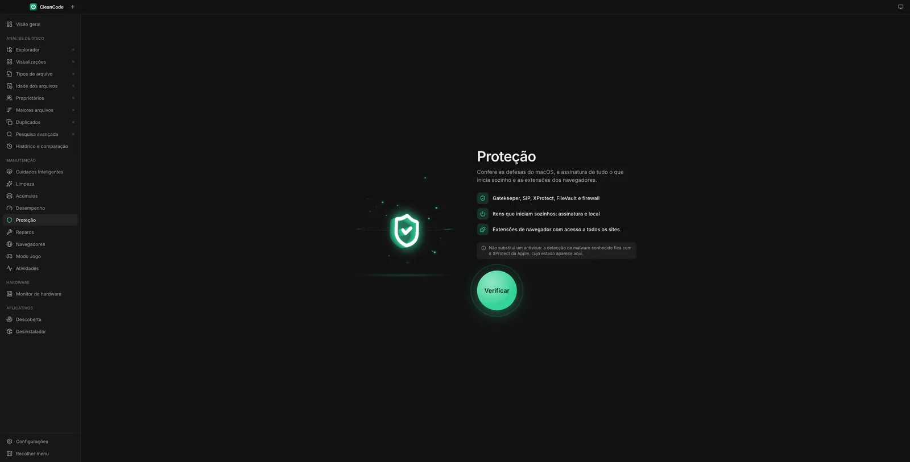<br /><strong>Proteção</strong><br />Confere se as defesas do sistema estão ligadas. Também confere a assinatura e o local de tudo o que inicia sozinho, e mostra as extensões de navegador que têm acesso a todos os sites.</td>
    <td width="50%" valign="top">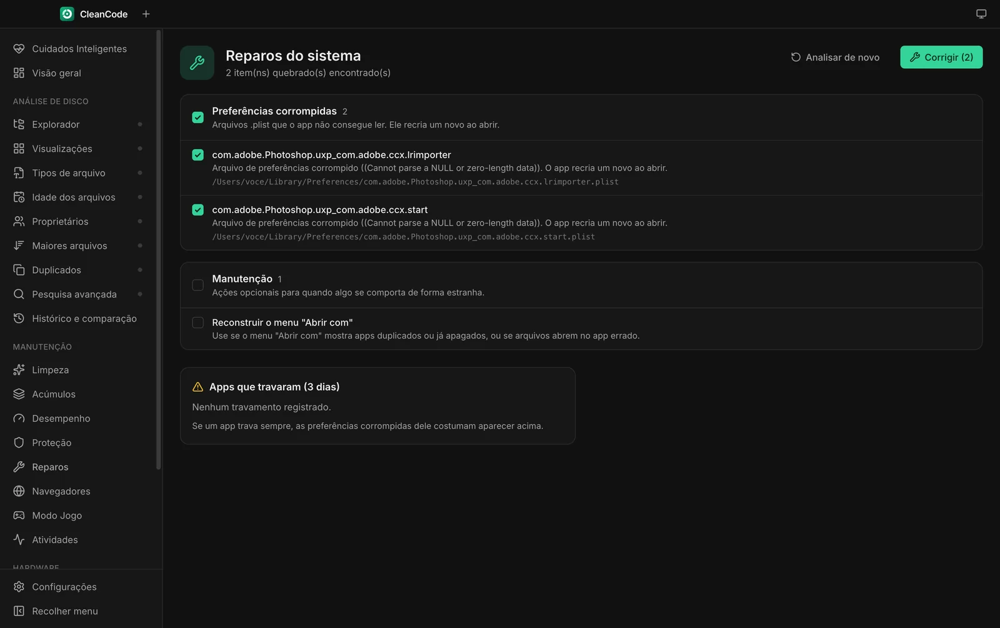<br /><strong>Registro do Windows e Reparos do macOS</strong><br />Mostra apenas os itens que estão comprovadamente quebrados. No Windows, o CleanCode salva uma cópia do registro (arquivo <code>.reg</code>) antes de corrigir. No Mac, ele corrige preferências corrompidas e agentes que apontam para apps apagados.</td>
  </tr>
  <tr>
    <td width="50%" valign="top">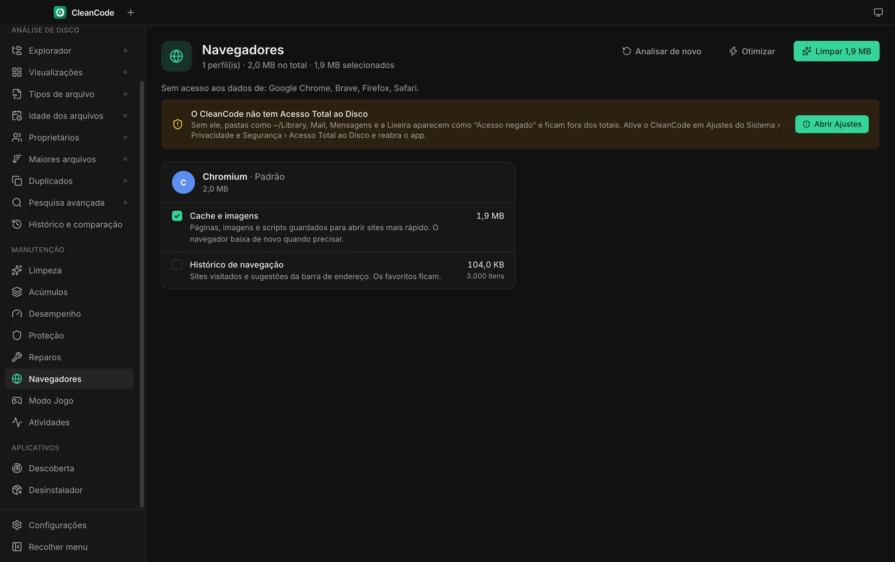<br /><strong>Navegadores</strong><br />Limpa o cache, o histórico, os downloads, os cookies, as sessões e o preenchimento automático de cada perfil. Além disso, compacta os bancos de dados internos dos navegadores.</td>
    <td width="50%" valign="top">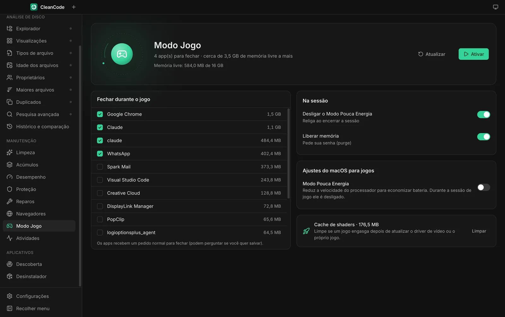<br /><strong>Modo Jogo</strong><br />Fecha os apps que pesam, libera memória e coloca o sistema em desempenho máximo. Quando você encerra a sessão, o CleanCode deixa tudo como estava antes.</td>
  </tr>
</table>

### Monitor de hardware

<table>
  <tr>
    <td width="50%" valign="top">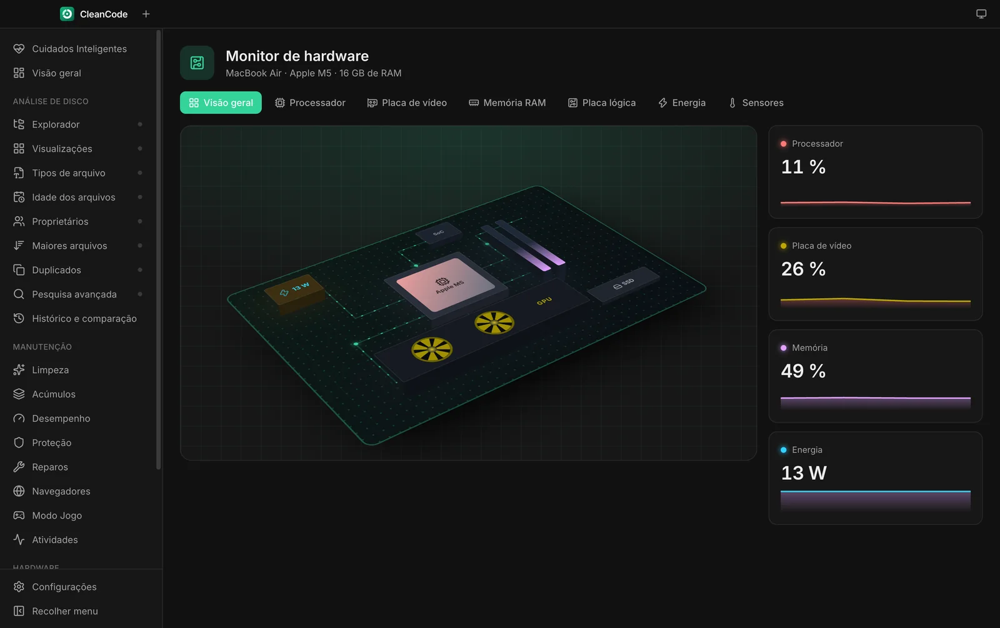<br /><strong>Visão geral</strong><br />Mostra o seu computador em 3D, seja um MacBook, um notebook ou um PC. A câmera se move ao redor do modelo, e os números ao vivo ficam ao lado.</td>
    <td width="50%" valign="top">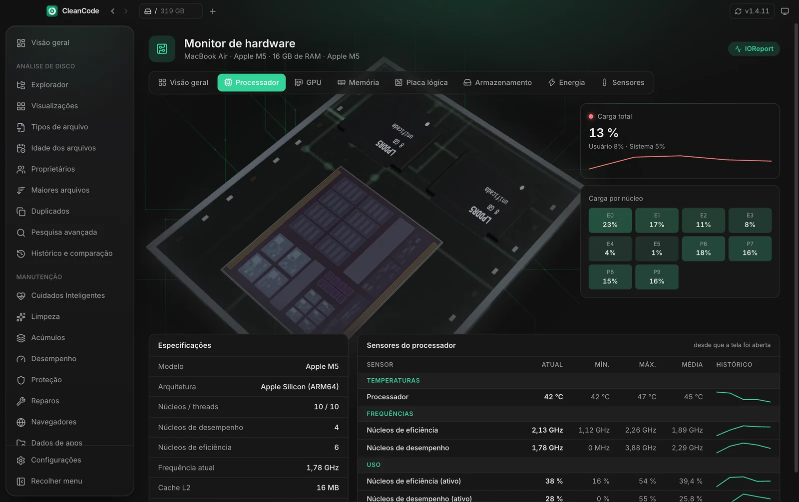<br /><strong>Processador</strong><br />Cada núcleo acende de acordo com a própria carga. A tela também mostra os núcleos de desempenho e de eficiência, a memória cache e a temperatura.</td>
  </tr>
  <tr>
    <td width="50%" valign="top">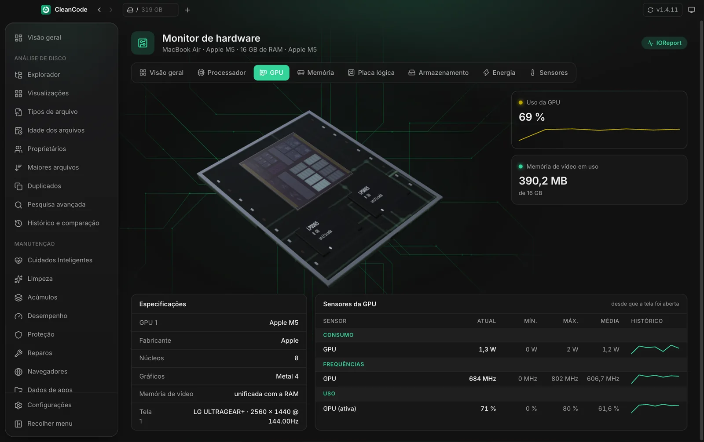<br /><strong>Placa de vídeo</strong><br />Mostra o uso da placa de vídeo, a memória de vídeo, o driver, a temperatura e as telas conectadas. No PC, as ventoinhas do modelo 3D giram mais rápido quando o uso aumenta.</td>
    <td width="50%" valign="top">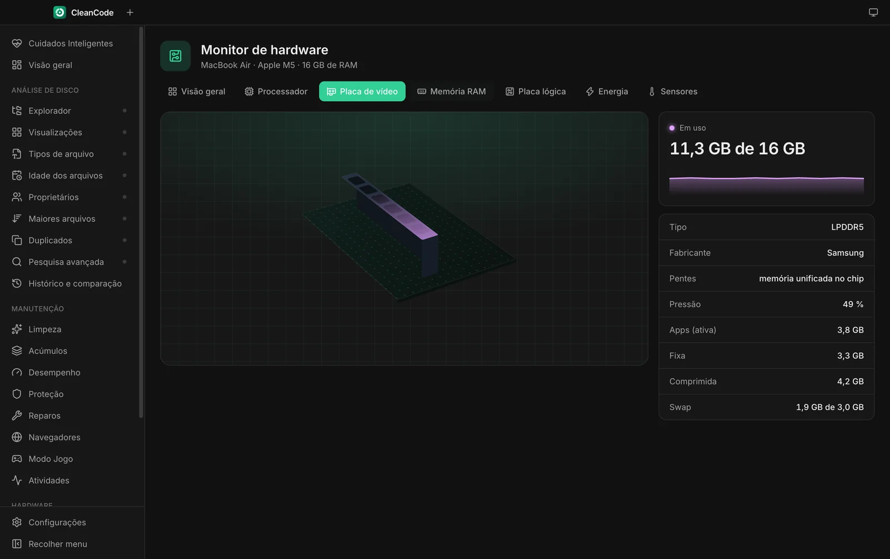<br /><strong>Memória RAM</strong><br />Mostra o tipo, a velocidade e o fabricante da memória, além dos slots ocupados. Também mostra a pressão de memória e o uso do swap, que é a memória extra guardada no disco.</td>
  </tr>
  <tr>
    <td width="50%" valign="top">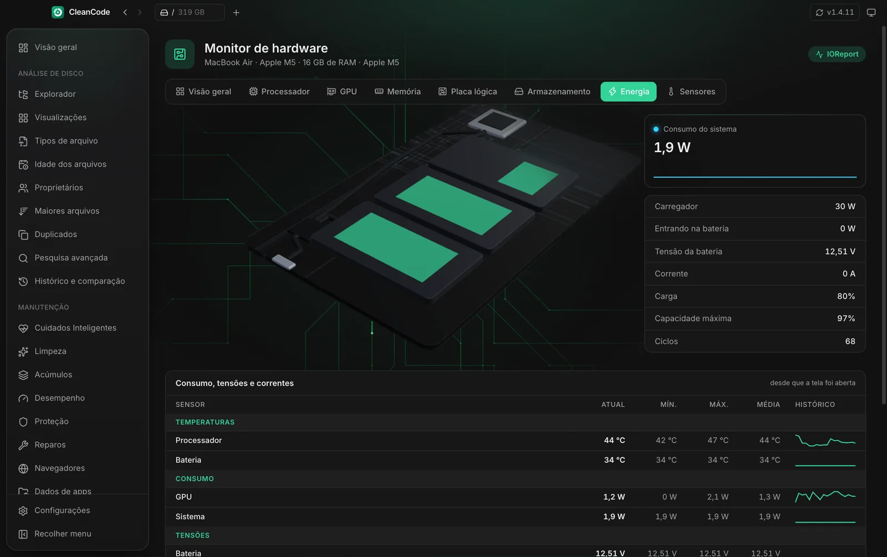<br /><strong>Energia</strong><br />Mostra quanto o computador consome em watts e quanto chega do carregador. Também mostra a tensão, a corrente e a saúde da bateria.</td>
    <td width="50%" valign="top">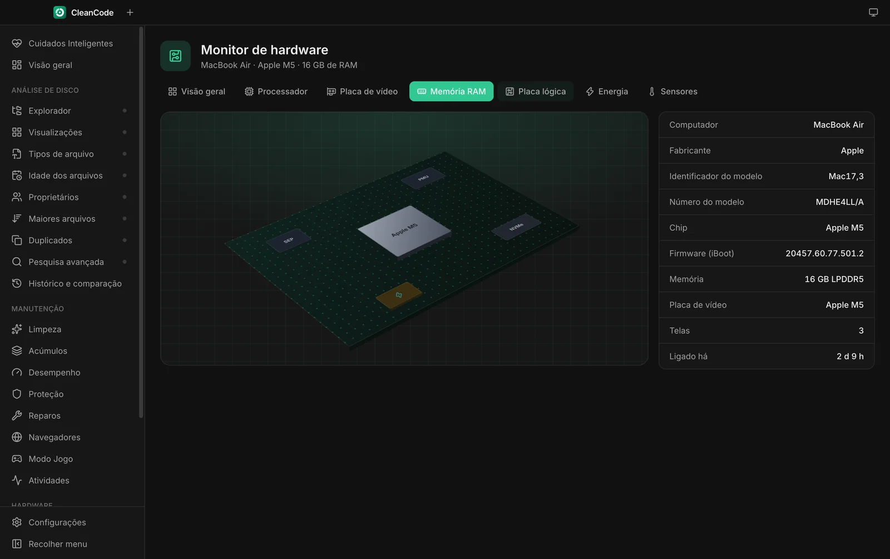<br /><strong>Placa-mãe e placa lógica</strong><br />Mostra o modelo da placa, o chip, a versão do firmware (ou da BIOS, no PC) e as tensões. No PC, também mostra as ventoinhas e os pentes de memória instalados.</td>
  </tr>
  <tr>
    <td width="50%" valign="top">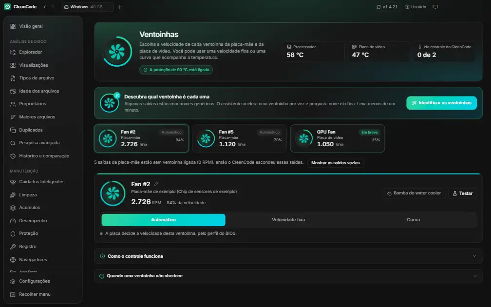<br /><strong>Ventoinhas</strong><br />No Windows, você escolhe uma velocidade fixa ou uma curva pela temperatura para cada ventoinha da placa-mãe. Um assistente descobre qual ventoinha é cada uma, e cada ventoinha volta ao modo automático quando você fecha o CleanCode.</td>
  </tr>
</table>

<details>
<summary><strong>Mais telas: armazenamento, sensores e desinstalador</strong></summary>
<br />
<table>
  <tr>
    <td width="50%" valign="top">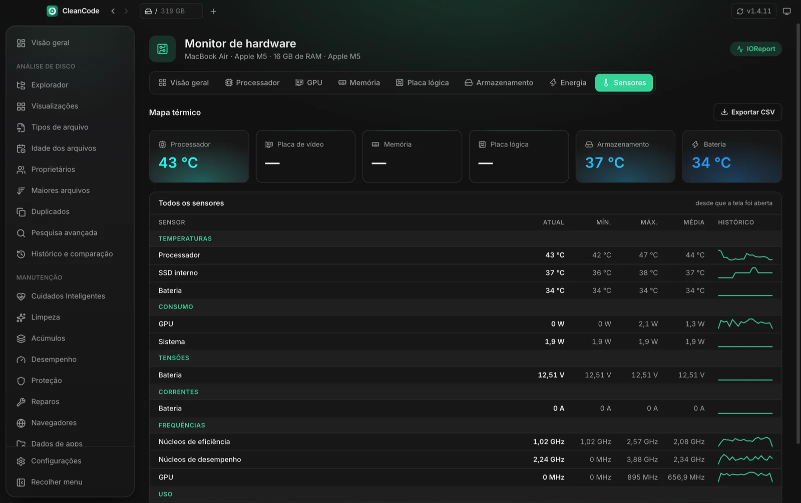<br /><strong>Sensores</strong><br />Mostra um mapa de temperaturas e uma tabela com o valor atual, o mínimo, o máximo e a média de cada sensor. Você pode exportar a tabela para uma planilha (arquivo CSV).</td>
    <td width="50%" valign="top">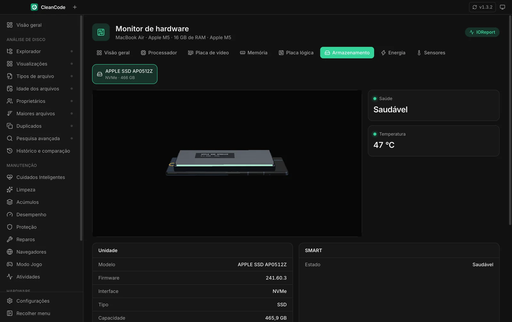<br /><strong>Armazenamento</strong><br />Mostra cada disco em 3D, com o modelo, a versão do firmware, a interface, a saúde, a temperatura e as partições.</td>
  </tr>
  <tr>
    <td width="50%" valign="top">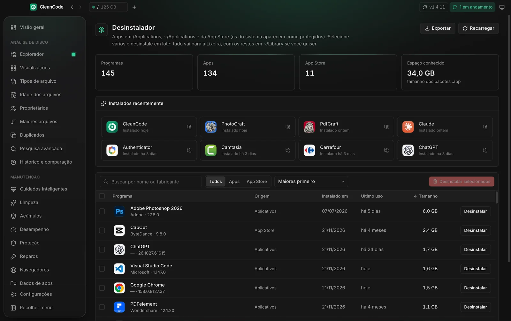<br /><strong>Desinstalador</strong><br />Remove apps, pacotes da loja e as sobras que eles deixam em <code>~/Library</code> (no Mac) ou no registro (no Windows). Você pode remover vários apps de uma vez, e tudo vai para a Lixeira.</td>
  </tr>
</table>
</details>

### Painel da barra de menus

<table>
  <tr>
    <td width="33%" valign="top">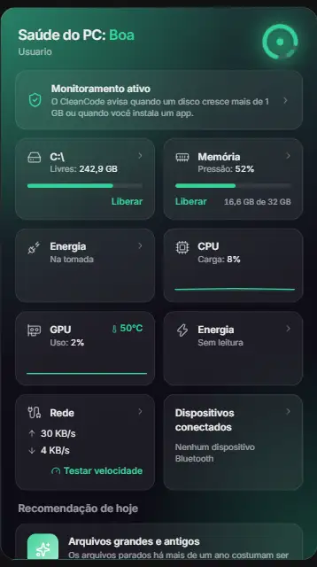<br /><strong>Saúde do computador</strong><br />Mostra o disco, a memória, a bateria, o processador, a placa de vídeo, a energia, a rede e os dispositivos conectados.</td>
    <td width="33%" valign="top">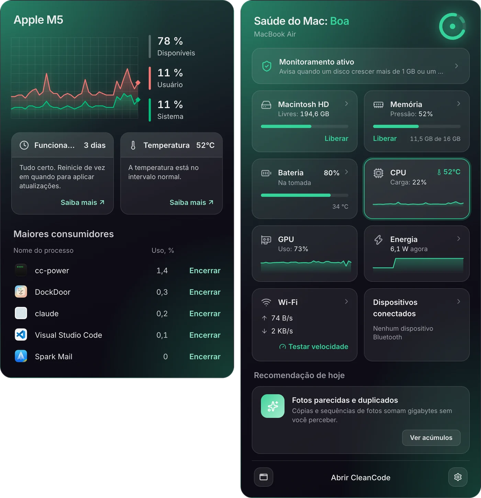<br /><strong>Processador</strong><br />Mostra quanto do processador está em uso pelos apps e pelo sistema. Também mostra a temperatura, o tempo ligado e os apps que mais usam o processador.</td>
    <td width="33%" valign="top">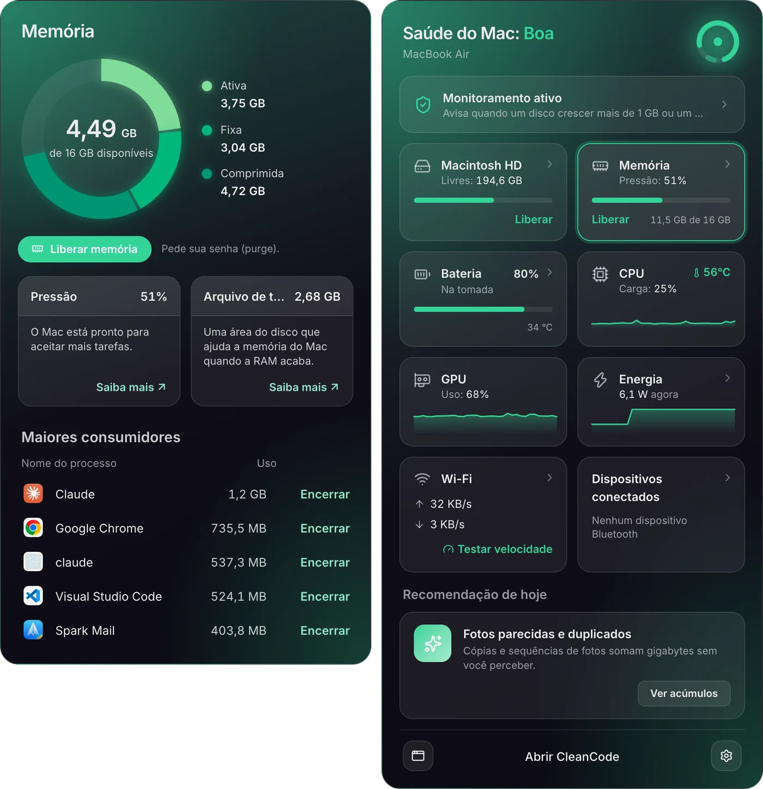<br /><strong>Memória</strong><br />Mostra como a memória está dividida, a pressão de memória, o uso do swap e os apps que mais usam memória.</td>
  </tr>
  <tr>
    <td width="33%" valign="top">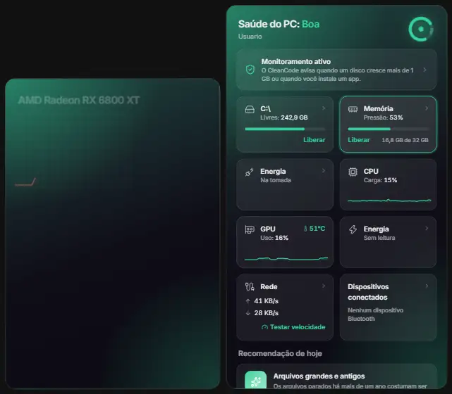<br /><strong>Placa de vídeo</strong><br />Mostra o uso ao vivo, os núcleos, a memória, as telas conectadas e a temperatura.</td>
    <td width="33%" valign="top">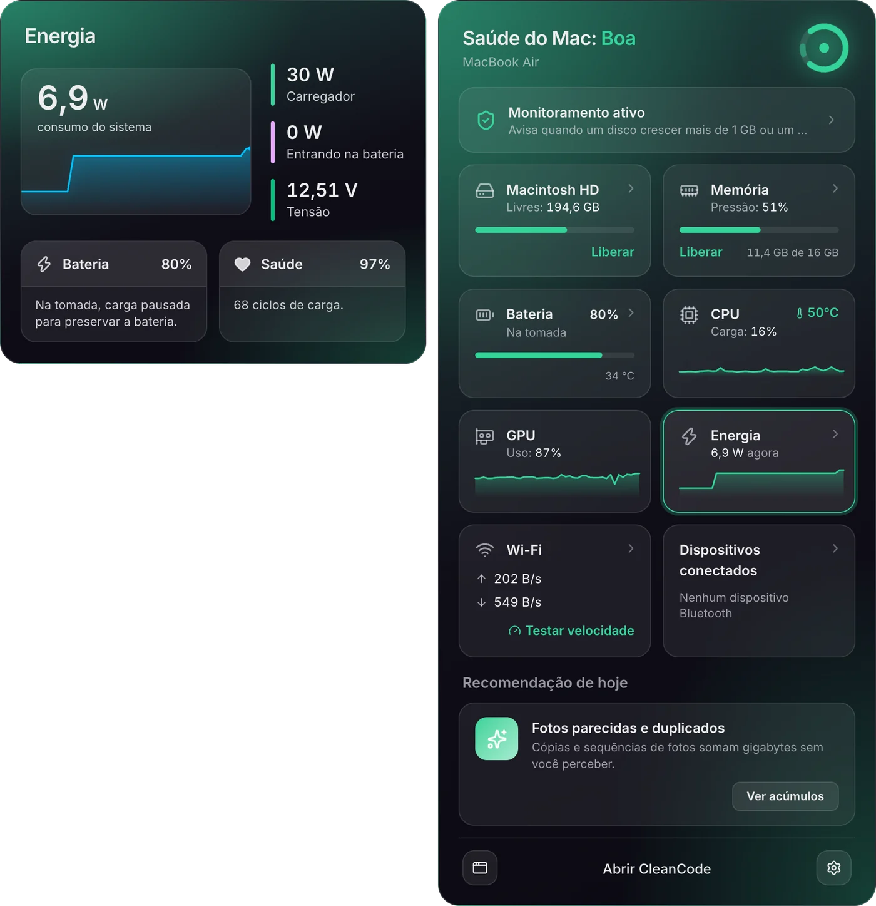<br /><strong>Energia</strong><br />Mostra o consumo do sistema em watts, a potência do carregador, a energia que entra na bateria e a tensão.</td>
    <td width="33%" valign="top">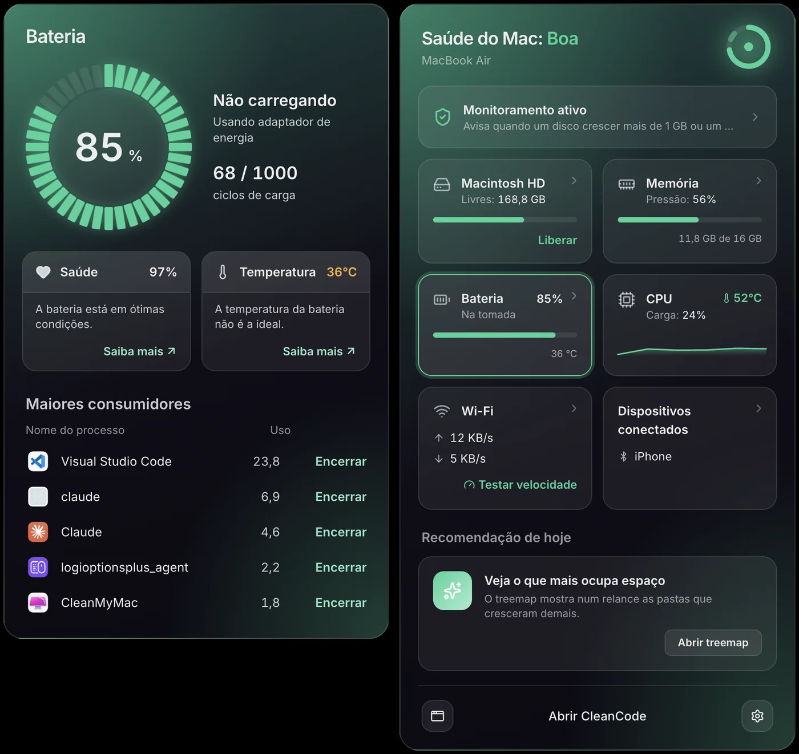<br /><strong>Bateria</strong><br />Mostra a carga, o número de ciclos, a capacidade máxima e a temperatura da bateria.</td>
  </tr>
  <tr>
    <td width="33%" valign="top">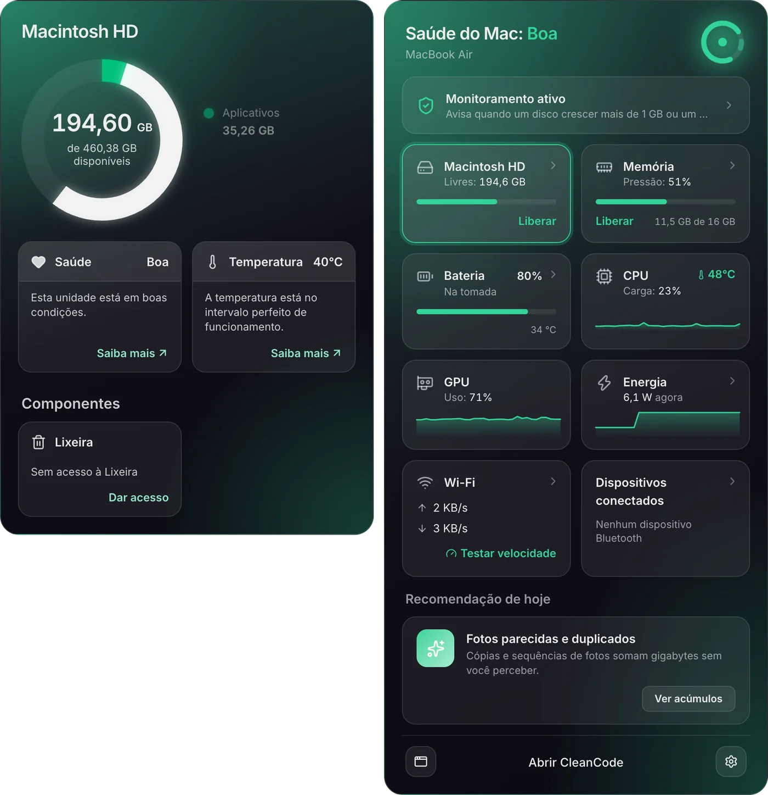<br /><strong>Armazenamento</strong><br />Mostra o que ocupa o disco, a saúde do SSD e o tamanho da Lixeira.</td>
    <td width="33%" valign="top">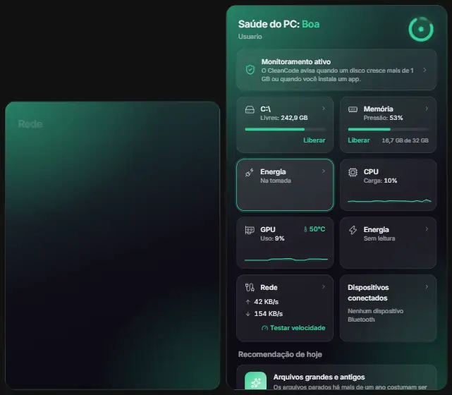<br /><strong>Rede</strong><br />Mostra se o Wi-Fi é seguro e quanto você baixou e enviou. Além disso, faz um teste de velocidade da internet.</td>
    <td width="33%" valign="top"></td>
  </tr>
</table>

## Tudo o que o CleanCode faz

<details open>
<summary><strong>Análise de disco</strong></summary>

- **A varredura é nativa e rápida.** No Windows, o CleanCode lê as pastas com a função `FindFirstFileExW` do sistema, por meio da biblioteca koffi, em uma thread separada. No macOS, ele usa `readdir` e `lstat` e calcula o tamanho que cada arquivo realmente ocupa no disco.
- **O Explorador** mostra as pastas em árvore. Você escolhe as colunas, como tamanho, espaço alocado, quantidade de arquivos, porcentagem e data.
- **As Visualizações** mostram a mesma pasta de três formas:
  - um mapa de blocos (treemap) com relevo, níveis de detalhe, rótulos e hierarquia;
  - um gráfico de pizza;
  - um gráfico de barras.
- **Outras telas de análise** mostram os tipos de arquivo, a idade dos arquivos, os donos dos arquivos, os maiores arquivos e os arquivos duplicados. Os duplicados são confirmados pelo conteúdo, e não apenas pelo nome.
- **A Pesquisa avançada** filtra arquivos por nome, tamanho, data e tipo.
- **O Histórico e comparação** mostra o que cresceu desde a última análise.
- Você pode exportar os resultados para uma planilha. Além disso, o menu do botão direito permite abrir o arquivo, mostrar o arquivo no Finder ou no Explorador e ver as propriedades.

</details>

<details open>
<summary><strong>Manutenção</strong></summary>

- **Cuidados Inteligentes** faz a limpeza, a verificação de proteção, a verificação de desempenho e a busca de apps esquecidos em uma única análise.
- **Limpeza**:
  - encontra os caches do sistema e dos apps, os registros de atividade (logs), a Lixeira, as sobras de ferramentas de desenvolvimento (como Xcode, npm e Gradle) e os downloads antigos;
  - deixa os itens sensíveis desmarcados e, por padrão, manda tudo para a Lixeira.
- **Acúmulos** encontra arquivos grandes e antigos, arquivos duplicados, fotos parecidas e o que ficou esquecido na pasta de Transferências. Para achar fotos parecidas, o CleanCode compara a aparência das imagens.
- **Desempenho**:
  - libera memória;
  - limpa o cache de DNS, que guarda os endereços dos sites;
  - reduz os instantâneos locais do Time Machine;
  - executa os scripts de manutenção do macOS e refaz o índice do Spotlight;
  - liga e desliga os itens que abrem junto com o computador;
  - mostra os apps que mais pesam.
- **Proteção**:
  - no Mac, confere o Gatekeeper, o SIP, o XProtect, o FileVault e o firewall; no Windows, confere o Defender, o UAC, o SmartScreen e o firewall;
  - confere a assinatura e o local de tudo o que inicia sozinho;
  - mostra as extensões de navegador que têm acesso a todos os sites.
- **Registro do Windows e Reparos do macOS**:
  - **No Windows**, o CleanCode encontra estes problemas:
    - itens de inicialização que apontam para um programa removido;
    - programas fantasmas, que aparecem na lista de instalados mas já foram removidos;
    - caminhos de apps (App Paths) quebrados;
    - entradas quebradas no menu "Abrir com" e no menu do botão direito;
    - entradas antigas no MuiCache;
    - atalhos quebrados;
    - serviços órfãos, que o CleanCode apenas mostra, sem mexer.

    Antes de cada mudança, o CleanCode salva uma cópia do registro em um arquivo `.reg`. Se algo der errado, você restaura a cópia na mesma tela.
  - **No macOS**, o CleanCode corrige preferências corrompidas (arquivos `.plist`), agentes de inicialização que apontam para apps apagados e links quebrados. Ele também refaz o menu "Abrir com".
  - A tela mostra os apps que travaram nos últimos 3 dias.
  - Quando um item quebrado novo aparece, o CleanCode avisa você, mesmo com a janela fechada.
- **Navegadores**:
  - funciona com Chrome, Edge, Brave, Opera, Opera GX, Vivaldi, Chromium, Firefox e Safari, separando cada perfil;
  - limpa o cache e as imagens, os dados da placa de vídeo, o histórico, o histórico de downloads, os cookies e os dados de sites, as sessões e o preenchimento automático;
  - compacta os bancos de dados internos dos navegadores com o comando `VACUUM`, o que deixa esses arquivos menores;
  - pede para fechar o navegador antes da limpeza e nunca fecha o navegador à força.
- **Dados de apps (AppData)**:
  - mostra o tamanho de cada pasta que os programas guardam no seu perfil (no Windows, `Local`, `Roaming` e `LocalLow`; no Mac, `Application Support` e `Caches`);
  - limpa com segurança os caches, os registros de atividade, os relatórios de travamento e as versões antigas que as atualizações deixam para trás;
  - encontra as sobras de programas desinstalados e manda essas sobras para a Lixeira.
- **Liberar memória** está disponível no painel, na aba Memória e no menu do ícone.
- **Modo Jogo**:
  - durante a sessão, fecha os apps em segundo plano e libera memória;
  - no Windows, ativa o plano de energia de alto desempenho; no Mac, desliga o Modo Pouca Energia;
  - dá prioridade alta para o jogo;
  - quando você encerra a sessão, deixa tudo como estava antes;
  - no Windows, também ajusta o Modo de Jogo, a gravação do Xbox e o agendamento da placa de vídeo;
  - limpa os caches de shaders do DirectX, da NVIDIA, da AMD, da Intel e do Metal, que podem ficar grandes com o tempo;
  - encontra sozinho os jogos da Steam, da Epic e da GOG, e você pode adicionar outras pastas de jogos.
- **Atividades** mostra o histórico de tudo o que o CleanCode fez e quanto espaço cada ação liberou.

</details>

<details open>
<summary><strong>Monitor de hardware</strong></summary>

- **Processador**:
  - mostra o modelo, a arquitetura, a quantidade de núcleos e de threads, e a divisão entre núcleos de desempenho e de eficiência;
  - mostra a frequência, a memória cache (L2 e L3) e a temperatura;
  - mostra a carga total, a carga dos apps, a carga do sistema e a carga de cada núcleo.
- **Placa de vídeo**:
  - mostra o modelo, o fabricante, os núcleos, a tecnologia gráfica (Metal ou DirectX), o driver, a memória de vídeo e a temperatura;
  - mostra as telas conectadas;
  - no Windows, mostra os programas que mais usam a placa de vídeo.
- **Memória RAM**: mostra o tipo (por exemplo, DDR4, DDR5 ou LPDDR5), a velocidade, o fabricante, os pentes e os slots. Também mostra como a memória está dividida, a pressão de memória e o uso do swap.
- **Placa-mãe e placa lógica**: mostra o fabricante, o modelo, a revisão, o chip, a versão da BIOS ou do firmware e a data dessa versão.
- **Energia**: mostra o consumo do sistema em watts, a potência do carregador, a energia que entra ou sai da bateria, a tensão, a corrente, os ciclos e a saúde da bateria.
- **Armazenamento**: mostra cada disco com o modelo, o firmware, a interface, a velocidade da conexão, o suporte a TRIM, a saúde, a temperatura, as horas de uso, os dados gravados e lidos, e as partições.
- **Sensores**: mostra uma tabela por peça com o valor atual, o mínimo, o máximo, a média e um pequeno gráfico de cada sensor. Também mostra um mapa de temperaturas, e você pode exportar tudo para um arquivo CSV.
  - **No Windows**, o CleanCode usa o **LibreHardwareMonitor**. Quando você liga o monitoramento avançado, que instala o driver assinado PawnIO, o CleanCode também lê a temperatura e a frequência de cada núcleo, as tensões, as ventoinhas da placa-mãe, o consumo e os dados SMART dos discos.
  - **No Mac**, o CleanCode lê a frequência e a atividade dos núcleos e da placa de vídeo, além do consumo de energia. Para isso, ele usa o IOReport do sistema e não pede senha.
- **Modelos 3D (feitos com three.js)**:
  - cada peça tem um modelo 3D com acabamento fosco: placa de vídeo, processador, memória, placa-mãe, SSD e energia;
  - na visão geral, o modelo é o seu computador: um PC com gabinete de vidro, um MacBook ou um notebook com Windows;
  - a câmera se move sozinha ao redor do modelo, e circuitos animados aparecem ao fundo.
- **Ventoinhas (Windows)**:
  - você escolhe, para cada ventoinha que aceita controle, o modo automático, uma velocidade fixa ou uma curva que acompanha uma temperatura;
  - se o processador ou a placa de vídeo chegar a 90 °C, as ventoinhas controladas vão para 100% até a temperatura cair para 85 °C;
  - depois de cada comando, o CleanCode confere o valor e o RPM que a placa informa, e devolve a ventoinha ao modo automático quando ela não obedece;
  - o assistente "Identificar as ventoinhas" acelera uma ventoinha por vez e pergunta onde ela fica, e um guia explica o que fazer quando uma ventoinha não obedece;
  - o controle da ventoinha da placa de vídeo chega numa próxima versão.

</details>

<details open>
<summary><strong>Aplicativos</strong></summary>

- **Desinstalador**:
  - encontra os apps em `/Applications` e em `~/Applications` no Mac, e os programas e os pacotes da Microsoft Store no Windows;
  - encontra as sobras dos apps em `~/Library` (no Mac) ou no registro (no Windows);
  - remove vários apps de uma vez e manda tudo para a Lixeira.
- **Dossiê do app**: cada app tem uma tela própria. Essa tela mostra quem criou o app, a licença, a versão, a data de instalação, o espaço ocupado e as pastas de dados do app.
- **Descoberta** mostra os apps que você não abre há meses e quanto espaço eles liberariam.
- **Aviso de instalação**: quando você instala um app, o CleanCode avisa quanto espaço ele ocupou.

</details>

<details open>
<summary><strong>Painel da barra de menus e da bandeja</strong></summary>

- O painel abre no canto da tela. No Mac, ele aparece no canto superior direito. No Windows, ele aparece no canto inferior direito.
- O painel tem cartões de disco, memória, bateria, processador, placa de vídeo, energia, rede e dispositivos. Quando você clica em um cartão, o detalhe abre ao lado.
- O **teste de velocidade** mede a latência, a velocidade de download e a velocidade de upload da sua internet.
- O painel também ejeta discos externos, mostra a bateria dos dispositivos Bluetooth e faz uma recomendação por dia.
- As cores seguem a cor de destaque que você escolheu no app, tanto no tema claro quanto no tema escuro.

</details>

<details open>
<summary><strong>Segundo plano e atualizações</strong></summary>

- O CleanCode fica na barra de menus (no Mac) ou na bandeja (no Windows). De lá, ele avisa quando um disco cresce além do limite, quando um app é instalado ou quando aparece um item quebrado.
- **Atualizações**: o CleanCode procura versões novas a cada 3 minutos e também quando o computador sai do repouso. Quando encontra uma versão nova, ele mostra um aviso no centro da tela com as novidades.
  - Se você clicar em **Atualizar agora**, o aviso mostra o download e cada etapa da instalação. O CleanCode só reinicia quando a instalação termina.
  - Se você preferir atualizar depois, o CleanCode baixa a versão nova sozinho e instala quando você fecha a janela.
  - Em todos os casos, o CleanCode baixa apenas o arquivo feito para o seu computador e confere o código SHA-512 do arquivo antes de instalar.
- Na primeira abertura depois de uma atualização, o CleanCode mostra uma janela com **as novidades da versão**.

</details>

## Segurança e privacidade

| O CleanCode… | Como ele faz isso |
|---|---|
| **Nunca apaga nada sem mostrar antes** | Toda remoção passa por uma lista que você revisa. Além disso, o CleanCode só apaga caminhos que apareceram na última análise. |
| **Prefere a Lixeira** | Arquivos, apps e atalhos vão para a Lixeira. O CleanCode só apaga de vez os arquivos de cache e os itens que você escolher. |
| **Faz uma cópia do registro** | Antes de mudar uma chave do registro, o CleanCode salva a chave em um arquivo `.reg`. Você restaura a cópia na mesma tela. |
| **Preserva senhas e favoritos** | O CleanCode nunca mexe nos arquivos de senhas, favoritos, cartões e endereços dos navegadores, como `Login Data`, `Bookmarks`, `logins.json` e `key4.db`. |
| **Pede permissão quando precisa** | As ações de administrador mostram o pedido do próprio sistema, ou seja, a senha do macOS ou a janela do UAC no Windows. |
| **Não coleta dados** | O CleanCode não tem conta nem telemetria. Ele só se conecta à internet para buscar atualizações no GitHub e para fazer o teste de velocidade na Cloudflare, quando você pede. |

## Download e instalação

Baixe a versão mais recente na página **[Releases](https://github.com/marquessrafa/cleancode/releases/latest)**:

| Sistema | Arquivo |
|---|---|
| macOS 12 ou mais novo, com Apple Silicon (M1, M2, M3, M4 ou M5) | `CleanCode-<versão>-macOS-Apple-Silicon.dmg` |
| macOS 12 ou mais novo, com processador Intel | `CleanCode-<versão>-macOS-Intel.dmg` |
| Windows 10 ou 11, de 64 bits | `CleanCode-<versão>-Windows-x64.exe` |

**No macOS:**

1. Abra o arquivo `.dmg` e arraste o CleanCode para a pasta Aplicativos.
2. O app tem uma assinatura própria, porque não usa uma conta paga de desenvolvedor da Apple. Por isso, na primeira abertura, clique no app com o botão direito e escolha **Abrir**. Outra opção é ir em Ajustes do Sistema, depois em Privacidade e Segurança, e clicar em **Abrir Mesmo Assim**.
3. Para que o CleanCode consiga analisar todas as pastas, dê a ele o **Acesso Total ao Disco** em Privacidade e Segurança. O app avisa quando falta essa permissão e abre o painel certo para você.

**No Windows:**

1. Abra o instalador.
2. O instalador não tem um certificado de assinatura pago, então o SmartScreen pode mostrar um aviso. Nesse caso, clique em **Mais informações** e depois em **Executar assim mesmo**.

> Os arquivos `.zip` do macOS e os arquivos `latest*.yml` da página Releases são usados pelo atualizador do app. Você não precisa baixar esses arquivos.

## Como o CleanCode funciona por dentro

| Camada | Tecnologia |
|---|---|
| Interface | React 19, Tailwind CSS 4, Vite 8 e ícones Lucide. |
| App | Electron 45 com Node 24. O processo principal conversa com as janelas por meio de um preload com `contextBridge`, e as janelas ficam isoladas (`sandbox` e `contextIsolation`). |
| Sistema operacional | A pasta `electron/platform/` tem as mesmas funções para cada sistema, separadas em `darwin/` (macOS) e `win32/` (Windows). |
| Windows | Chamadas diretas às funções do Windows com a biblioteca [koffi](https://koffi.dev) (por exemplo, `FindFirstFileExW` e `GetCompressedFileSizeW`), além de PowerShell, CIM, `reg.exe` e contadores de desempenho. |
| macOS | Ferramentas do sistema, como `diskutil`, `system_profiler`, `ioreg`, `launchctl`, `pmset`, `plutil`, `codesign` e `spctl`. Os sensores são lidos por um programa próprio escrito em C (`cc-sensors`). |
| Dados dos navegadores | O módulo `node:sqlite` (`DatabaseSync`), que já vem no Node 24. |
| 3D | [three.js](https://threejs.org) com modelos próprios, acabamento fosco e uma câmera que se move sozinha. |
| Sensores | No Windows, o [LibreHardwareMonitor](https://github.com/LibreHardwareMonitor/LibreHardwareMonitor) (por meio de um programa auxiliar em C#) e, se você quiser, o driver [PawnIO](https://pawnio.eu). No macOS, o IOReport (`cc-power`) e o IOHID (`cc-sensors`). |
| Trabalho pesado | A varredura, o cálculo de tamanhos, a limpeza e os acúmulos rodam em `worker_threads`, então a interface não trava. |
| Build e distribuição | O electron-builder gera os instaladores (NSIS, DMG e ZIP). O GitHub Actions compila os dois sistemas e publica um feed de atualização com uma entrada por arquitetura e com a verificação SHA-512. |

Estas são as pastas principais do projeto:

```
electron/            processo principal, comunicação entre janelas, workers e atualizador
electron/platform/   tudo o que conversa com o sistema operacional (darwin/ e win32/)
native/macos/        programa auxiliar que lê os sensores no Mac (escrito em C)
src/pages/           telas do app
src/panel/           painel da barra de menus e da bandeja
release-notes/       notas técnicas de cada versão
docs/                guia de desenvolvimento, traduções do README e capturas de tela
```

## Como compilar a partir do código

Você precisa do Node.js 22 ou mais novo e do npm. No macOS, você também precisa das Command Line Tools do Xcode, porque elas compilam o programa que lê os sensores.

```bash
git clone https://github.com/marquessrafa/cleancode.git
```

```bash
cd cleancode && npm install
```

```bash
npm start
```

Para gerar os instaladores, use um destes comandos:

```bash
npm run dist:mac
```

```bash
npm run dist
```

- O comando `npm run dist:mac` roda no Mac e gera os arquivos `.dmg` e `.zip` para Apple Silicon e para Intel.
- O comando `npm run dist` roda no Windows e gera o instalador de 64 bits.
- Quando você cria uma tag no formato `vX.Y.Z`, o GitHub Actions compila os dois sistemas e publica a versão com as notas do arquivo `release-notes/<versão>.md`.

O guia [docs/DESENVOLVIMENTO.md](../DESENVOLVIMENTO.md) tem mais detalhes.

## Inspiração

O CleanCode começou como um analisador de disco para Windows inspirado no **TreeSize**, da JAM Software. Essa primeira versão já tinha a varredura rápida, a árvore de pastas, o treemap e as telas de tipos, de idade, de donos e de duplicados. Depois, quando chegou ao macOS, o CleanCode ganhou as áreas de manutenção e o painel na barra de menus, inspirados no **CleanMyMac**, da MacPaw. A partir daí, vieram recursos próprios, como o monitor de hardware em 3D, o Modo Jogo e os reparos do registro.

O CleanCode é um projeto independente, com design e código próprios. Ele não tem ligação com a JAM Software nem com a MacPaw, e não usa código, imagens ou recursos de outros produtos. Os nomes citados pertencem aos seus donos.

## Licença

O CleanCode usa a licença [MIT](../../LICENSE). Isso significa que você pode usar, estudar, modificar e distribuir o código à vontade.

O app usa estas bibliotecas de terceiros: three.js (licença MIT) e LibreHardwareMonitorLib (licença MPL 2.0). O driver PawnIO (licença GPL-2.0) não vem junto com o CleanCode. Ele é baixado do site oficial e instalado à parte, e só quando você liga o monitoramento avançado.
